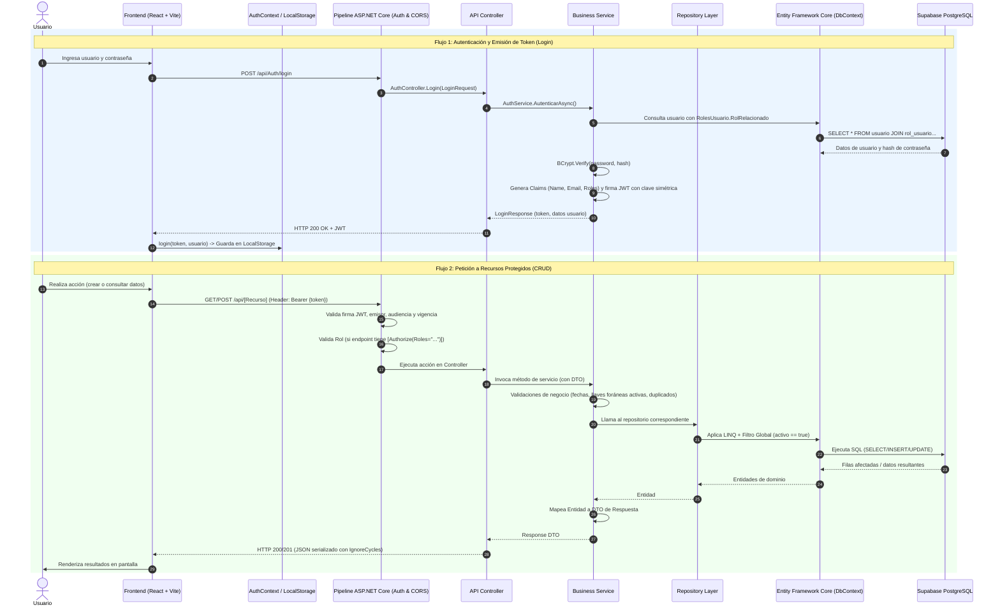

# Arquitectura Actual del Proyecto: Módulo Mapa de Conocimiento

> **Fecha del informe:** Octubre 2026  
> **Estado del repositorio:** En transición entre Fase 2 (Integridad Referencial) y Fase 3 (Seguridad, JWT y Gestión de Usuarios).

---

## Resumen Ejecutivo

El proyecto **Módulo: Mapa de Conocimiento** es una aplicación web full-stack institucional desarrollada para la **Universidad de San Buenaventura (USB)**. Su propósito es consolidar, mapear y gestionar la producción investigativa, proyectos, docentes, aliados, líneas de investigación y áreas del conocimiento, articulándolos con los Objetivos de Desarrollo Sostenible (ODS).

El proyecto se diseñó bajo una metodología incremental dividida en 4 fases según la especificación (`Documentacion/`):
- **Fase 0:** Infraestructura base, modelo de 21 tablas en Supabase (PostgreSQL), solución en C# y repositorio.
- **Fase 1:** CRUD con borrado lógico para 8 tablas maestras independientes.
- **Fase 2:** Integridad referencial, entidades fuertes (`docente`, `producto`) y 8 tablas puente de relación n-aria.
- **Fase 3:** Autenticación por tokens (JWT), control de acceso basado en roles (RBAC) y panel de administración de usuarios *(actualmente implementada a nivel de código local pendiente de integración completa)*.
- **Fase 4:** Analítica con 10 consultas multitabla complejas (JOINs), Dashboard gerencial, identidad institucional y despliegue público en la nube.

---

## 1. Tecnologías y Librerías Utilizadas

El sistema está construido como una arquitectura desacoplada: una **API REST en ASP.NET Core** y una **Single Page Application (SPA) en React**.

### 1.1 Backend (.NET Web API)

| Componente | Tecnología / Librería | Versión | Propósito |
|---|---|---|---|
| **Runtime & SDK** | .NET (C#) | `10.0` (`net10.0`) | Entorno de ejecución principal de la API. |
| **Framework Web** | ASP.NET Core Web API | `10.0` | Arquitectura de controladores y middlewares HTTP. |
| **ORM / Acceso a Datos** | Entity Framework Core | `8.0.8` | Mapeo objeto-relacional (ORM), LINQ, transacciones y migraciones/scaffolding. |
| **Driver PostgreSQL** | `Npgsql.EntityFrameworkCore.PostgreSQL` | `8.0.8` | Proveedor oficial de EF Core para PostgreSQL / Supabase. |
| **Diseño / Herramientas EF** | `Microsoft.EntityFrameworkCore.Design` | `8.0.8` | Soporte para herramientas de diseño de EF Core. |
| **Base de Datos** | PostgreSQL (Supabase) | Cloud (AWS us-west-1) | Base de datos relacional con Connection Pooling transaccional. |
| **Autenticación** | `Microsoft.AspNetCore.Authentication.JwtBearer` | `10.0.12` | Middleware para validar tokens Bearer JWT en cabeceras HTTP. |
| **Manejo de Tokens** | `System.IdentityModel.Tokens.Jwt`, `Microsoft.IdentityModel.Tokens` | Integrado | Construcción, reclamos (Claims) y firma criptográfica HMAC-SHA256. |
| **Cifrado de Contraseñas** | `BCrypt.Net-Next` | `4.2.0` | Algoritmo de hash unidireccional y salting para contraseñas de usuarios. |
| **Documentación API** | `Swashbuckle.AspNetCore` | `6.6.2` | Generación de especificación OpenAPI y UI interactiva Swagger con soporte para Bearer Token. |
| **Herramienta de Ingeniería Inversa** | EF Core Power Tools (`efpt.config.json`) | `2.6.x` | Herramienta utilizada para el scaffold inicial de tablas de base de datos a modelos C#. |

### 1.2 Frontend (React SPA)

| Componente | Tecnología / Librería | Versión | Propósito |
|---|---|---|---|
| **Bundler / Build Tool** | Vite | `8.2.2` | Servidor de desarrollo HMR ultrarrápido y empaquetador para producción. |
| **Librería UI** | React | `19.2.8` | Biblioteca base para la interfaz declarativa por componentes. |
| **DOM Renderer** | React DOM | `19.2.8` | Montaje del árbol de componentes en el DOM del navegador. |
| **Enrutamiento** | `react-router-dom` | `7.18.4` | Enrutador del lado del cliente (`BrowserRouter`, `Routes`, `Route`, `Navigate`). |
| **Cliente HTTP** | Axios | `1.20.0` | Cliente HTTP con instancia personalizada e interceptores de cabecera JWT. |
| **Decodificación JWT** | `jwt-decode` | `4.0.0` | Decodificación del payload del token JWT en cliente para validar expiración (`exp`). |
| **Iconos** | `lucide-react` | `1.45.0` | Iconografía SVG ligera para navegación y acciones. |
| **Framework CSS** | Tailwind CSS | `4.3.3` (`@tailwindcss/vite`) | Utilidades CSS de última generación con tema institucional USB configurado en `@theme`. |
| **Post-procesadores** | PostCSS, Autoprefixer | `8.5.28` / `10.6.0` | Procesamiento y compatibilidad de estilos en cascada. |
| **Linter de Código** | ESLint + Plugins React | `10.9.0` | Verificación estática de reglas de sintaxis y Hooks. |

---

## 2. Organización de Carpetas y Estructura del Proyecto

El repositorio raíz contiene la solución con el backend y el subdirectorio del frontend integrado:

```text
borrar2/
├── .git/                                # Repositorio Git principal
├── ARQUITECTURA_ACTUAL.md              # Este documento de análisis arquitectónico
└── mapa_conocimiento_api/               # Directorio principal del proyecto (C# + Frontend)
    ├── .gitignore
    ├── appsettings.json                 # Configuración general (Supabase, JwtSettings, Logging)
    ├── appsettings.Development.json     # Configuración para entorno de desarrollo local
    ├── efpt.config.json                 # Configuración de ingeniería inversa EF Core Power Tools
    ├── mapa_conocimiento_api.csproj     # Archivo de definición del proyecto .NET y paquetes NuGet
    ├── mapa_conocimiento_api.slnx       # Archivo de solución XML moderna de Visual Studio
    ├── Program.cs                       # Punto de entrada del Backend: Inyección de dependencias y middlewares
    │
    ├── Controllers/                     # CAPA CONTROLADORES (20 Controllers API REST)
    │   ├── AuthController.cs            # Login y emisión de JWT
    │   ├── UsuarioController.cs         # CRUD de usuarios y asignación de roles (RBAC: Solo Administrador)
    │   ├── DocenteController.cs         # CRUD y relaciones de Docentes
    │   ├── ProductoController.cs        # CRUD de Productos de investigación
    │   ├── ProyectoController.cs        # CRUD de Proyectos institucionales
    │   ├── AreaConocimientoController.cs# Tablas maestras Fase 1...
    │   ├── ObjetivoDesarrolloSostenibleController.cs
    │   ├── LineaInvestigacionController.cs
    │   ├── AliadoController.cs
    │   ├── TerminoClaveController.cs
    │   ├── TipoProductoController.cs
    │   ├── AreaAplicacionController.cs
    │   ├── AliadoProyectoController.cs  # Tablas puente Fase 2 (relaciones N a N)...
    │   ├── DesarrollaController.cs
    │   ├── DocenteProductoController.cs
    │   ├── AcProyectoController.cs
    │   ├── AaProyectoController.cs
    │   ├── OdsProyectoController.cs
    │   ├── PalabrasClaveController.cs
    │   └── ProyectoLineaController.cs
    │
    ├── Services/                        # CAPA DE NEGOCIO Y SERVICIOS (Interfaces e Implementaciones)
    │   ├── IAuthService.cs / AuthService.cs
    │   ├── IUsuarioService.cs / UsuarioService.cs
    │   ├── IDocenteService.cs / DocenteService.cs
    │   ├── IProductoService.cs / ProductoService.cs
    │   ├── IProyectoService.cs / ProyectoService.cs
    │   └── [Resto de IServicio.cs y Servicio.cs correspondientes a cada entidad]
    │
    ├── Repositories/                    # CAPA DE ACCESO A DATOS (Interfaces e Implementaciones EF Core)
    │   ├── IUsuarioRepository.cs / UsuarioRepository.cs
    │   ├── IDocenteRepository.cs / DocenteRepository.cs
    │   ├── IProductoRepository.cs / ProductoRepository.cs
    │   ├── IProyectoRepository.cs / ProyectoRepository.cs
    │   └── [Resto de IRepository.cs y Repository.cs de entidades y tablas puente]
    │
    ├── Models/                          # CAPA DE DOMINIO Y PERSISTENCIA
    │   ├── postgresContext.cs           # DbContext con DbSets, llaves compuestas y filtros globales
    │   ├── usuario.cs                   # Entidad Usuario (credenciales, roles)
    │   ├── rol.cs                       # Entidad Rol
    │   ├── rol_usuario.cs               # Entidad puente Usuario-Rol
    │   ├── docente.cs                   # Entidad Docente con mapeo de columnas y FKs
    │   ├── producto.cs                  # Entidad Producto con FK a Proyecto y TipoProducto
    │   ├── proyecto.cs                  # Entidad Proyecto con validaciones de fechas
    │   ├── aliado.cs, area_conocimiento.cs, objetivo_desarrollo_sostenible.cs...
    │   └── desarrolla.cs, aliado_proyecto.cs, docente_producto.cs... (Tablas puente)
    │
    ├── Peticiones/                      # OBJETOS DE TRANSFERENCIA DE DATOS (DTOs de Entrada y Salida)
    │   ├── LoginRequest.cs / LoginResponse.cs
    │   ├── UsuarioCrear.cs / UsuarioResponse.cs
    │   ├── DocenteCrear.cs / DocenteEditar.cs / DocenteResponse.cs
    │   ├── ProductoCrear.cs / ProductoEditar.cs / ProductoResponse.cs
    │   ├── ProyectoCrear.cs / ProyectoEditar.cs
    │   ├── LineaInvestigacionCrear.cs.cs # (Nota: archivo con doble extensión detectado)
    │   └── [Demás clases *Crear.cs y *Editar.cs]
    │
    ├── Documentacion/                   # ESPECIFICACIONES METODOLÓGICAS INCREMENTALES
    │   ├── sped kit_v1/                 # Fase 1: Tablas independientes (spec, plan, data model, etc.)
    │   ├── sped kit_v2/                 # Fase 2: Integridad referencial y tablas puente
    │   ├── sped kit_v3/                 # Fase 3: Seguridad, Autenticación y Usuarios
    │   └── sped kit_v4/                 # Fase 4: Analítica, Consultas complejas y Dashboard
    │
    ├── Properties/
    │   └── launchSettings.json          # Configuración Kestrel local en http://localhost:5000
    │
    └── Frontend/                        # APLICACIÓN CLIENTE (React + Vite)
        ├── package.json                 # Dependencias y scripts del frontend
        ├── vite.config.js               # Configuración del plugin de React y Tailwind para Vite
        ├── index.html                   # HTML base con el punto de montaje #root
        ├── src/
        │   ├── main.jsx                 # Entrada React (StrictMode, AuthProvider)
        │   ├── App.jsx                  # Definición de rutas (Login, Dashboard, PanelUsuarios)
        │   ├── index.css                # Importación de Tailwind y definición de colores institucionales
        │   │
        │   ├── api/
        │   │   └── axiosConfig.js       # Instancia Axios con interceptor de autorización Bearer
        │   │
        │   ├── context/
        │   │   └── AuthContext.jsx      # Contexto React para estado de sesión, token y expiración
        │   │
        │   ├── components/
        │   │   ├── Navbar.jsx           # Barra institucional superior con control condicional por rol
        │   │   ├── ProtectedRoute.jsx   # Guardia de rutas autenticadas
        │   │   ├── layout/
        │   │   │   ├── LayoutFormulario.jsx
        │   │   │   └── LayoutFormulario.css
        │   │   ├── ui/
        │   │   │   ├── InputInstitucional.jsx # Campo de texto reusable con validación visual
        │   │   │   └── InputInstitucional.css
        │   │   └── formularios/         # Formularios de captura de datos (Fase 1)
        │   │       ├── FormProyecto.jsx
        │   │       ├── FormAreaConocimiento.jsx
        │   │       ├── FormObjetivoDesarrolloSostenible.jsx
        │   │       ├── FormAreaAplicacion.jsx
        │   │       ├── FormTerminoClave.jsx
        │   │       ├── FormLineaInvestigacion.jsx
        │   │       ├── FormTipoProducto.jsx
        │   │       ├── FormAliado.jsx
        │   │       └── Formularios.css
        │   │
        │   └── pages/
        │       ├── Login.jsx            # Pantalla de inicio de sesión con branding USB
        │       ├── Dashboard.jsx        # Contenedor dinámico de formularios Fase 1
        │       └── PanelUsuarios.jsx    # Módulo exclusivo de administración de usuarios (Admin)
        └── dist/                        # Compilado estático de producción generado por Vite
```

---

## 3. Flujo Principal de Datos y Ejecución

La arquitectura sigue una separación clásica de 3 capas en el backend (**Controller -> Service -> Repository -> Database**) y un modelo de aplicación de página única (**SPA**) guiada por estado global y almacenamiento local en el cliente.

### 3.1 Diagrama General del Flujo de Ejecución



### 3.2 Detalle del Ciclo de Vida y Flujo Paso a Paso

1. **Arranque del Backend (`Program.cs`):**
   - Configura serialización JSON evitando referencias circulares (`ReferenceHandler.IgnoreCycles`).
   - Configura **Swagger** con el esquema de seguridad Bearer.
   - Configura el servicio de autenticación JWT leyendo la clave secreta, emisor, audiencia y vigencia desde `appsettings.json`.
   - Registra el `postgresContext` apuntando a Supabase mediante `UseNpgsql`.
   - Inyecta con ciclo de vida **Scoped** los 20 repositorios y los 20 servicios.
   - Habilita política de **CORS** `PermitirFrontend` para aceptar orígenes cruzados.
   - Activa el pipeline: `UseHttpsRedirection` -> `UseCors` -> `UseAuthentication` -> `UseAuthorization` -> `MapControllers`.

2. **Arranque del Frontend (`main.jsx` -> `App.jsx`):**
   - El árbol de React se envuelve en `AuthProvider` (`AuthContext.jsx`).
   - Al cargar la página, `AuthContext` revisa `localStorage` buscando `token` y `usuario`.
   - Con `jwtDecode`, valida si el tiempo actual supera `decoded.exp`. Si expiró, llama a `logout()` y limpia el almacenamiento.
   - `App.jsx` define las rutas con `react-router-dom`:
     - `/login`: Pública.
     - `/dashboard`: Protegida por `<ProtectedRoute>`. Carga el `Navbar` y `Dashboard` (formularios).
     - `/usuarios`: Protegida por `<ProtectedRoute>`. Carga el `PanelUsuarios` (gestión de cuentas).
     - Ruta comodín `*`: Redirige al `/dashboard`.

3. **Mapeo de Datos y Borrado Lógico en Base de Datos:**
   - **Borrado Lógico Global:** `postgresContext.cs` aplica `HasQueryFilter(x => x.activo)` en casi todas las entidades. Ningún registro se elimina físicamente con `DELETE`; se ejecuta `entidad.activo = false`.
   - **Llaves Compuestas:** Todas las tablas puente (ej. `aliado_proyecto`, `desarrolla`, `docente_producto`, `rol_usuario`) tienen sus llaves compuestas declaradas en `OnModelCreating`.
   - **Eager Loading Relacional:** En entidades con relaciones (como `Docente`), el repositorio utiliza `.Include(d => d.LineaInvestigacionRelacionada)` para traer entidades relacionadas en una única consulta SQL.

---

## 4. Partes Más Complejas, Confusas o Críticas del Código

Durante la exploración detallada del código fuente se identificaron varios puntos de alta complejidad técnica, inconsistencias arquitectónicas y riesgos potenciales que requieren atención prioritaria:

### 4.1 Bug Crítico: Desconexión entre la Autenticación de Fase 3 y los Formularios del Frontend
* **Dónde ocurre:** `Frontend/src/components/formularios/*.jsx` (como `FormProyecto.jsx`, `FormAreaConocimiento.jsx`, etc.) frente a `Controllers/*.cs`.
* **Explicación:** En la Fase 3, se agregaron atributos `[Authorize]` a todos los controladores del backend. En el frontend se configuró Axios (`api/axiosConfig.js`) con un interceptor que inyecta la cabecera `Authorization: Bearer ${token}`. Sin embargo, **todos los formularios existentes siguen utilizando la función nativa `fetch()` hardcodeada directamente**:
  ```javascript
  // Ejemplo en FormProyecto.jsx
  const respuesta = await fetch('http://localhost:5000/api/proyecto', {
    method: 'POST',
    headers: { 'Content-Type': 'application/json' },
    body: JSON.stringify(payload)
  });
  ```
* **Impacto:** Como `fetch` no envía la cabecera `Authorization`, **cualquier intento de guardar datos desde estos formularios fallará inmediatamente con un error HTTP 401 Unauthorized** a pesar de que el usuario haya iniciado sesión correctamente. Solo `PanelUsuarios.jsx` y `Login.jsx` usan la instancia configurada de Axios.

### 4.2 Inconsistencia Arquitectónica en la Capa de Servicios (`AuthService`)
* **Dónde ocurre:** `mapa_conocimiento_api/Services/AuthService.cs` frente al resto de la solución.
* **Explicación:** Todo el proyecto sigue rigurosamente el patrón de diseño en capas: `Controller` -> `Service` -> `Repository` -> `postgresContext`. Sin embargo, `AuthService` rompe este estándar e inyecta directamente `postgresContext` y `IConfiguration` en el servicio, realizando consultas LINQ directas sobre la base de datos sin pasar por `IUsuarioRepository`. En contraste, `UsuarioService` sí utiliza `IUsuarioRepository`.

### 4.3 Manejo Asimétrico del Borrado Lógico y Duplicados (`IgnoreQueryFilters`)
* **Dónde ocurre:** `Repositories/TerminoClaveRepository.cs`, `Repositories/AliadoRepository.cs`, `Repositories/DocenteRepository.cs` vs. los demás repositorios.
* **Explicación:** Dado que existe el filtro global `activo == true`, una búsqueda estándar ignora los registros con `activo = false`. Si un usuario intenta volver a crear una entidad con una llave natural o cédula que ya existía pero fue borrada lógicamente:
  - En `TerminoClaveRepository`, `AliadoRepository` y `DocenteRepository`, se implementó `.IgnoreQueryFilters()` para buscar si existe un registro inactivo y "reactivarlo" (`activo = true`) actualizando sus datos.
  - En los demás repositorios (como `AreaConocimiento`, `LineaInvestigacion`, etc.), esta lógica **no existe**. Si se intenta registrar un registro previamente inactivado que tenga una restricción `UNIQUE` en PostgreSQL, la base de datos disparará una excepción no controlada de violación de restricción única.
  - Además, en `DocenteService.cs`, la validación de duplicados se ejecuta primero en el servicio usando `ObtenerPorIdAsync` (que tiene el filtro activo y por ende no ve registros inactivos), y luego el repositorio vuelve a realizar una validación con `IgnoreQueryFilters`. Hay duplicidad y ambigüedad en la responsabilidad de validación.

### 4.4 Campo con Error Tipográfico Heredado de la BD (`nacionalidaad`)
* **Dónde ocurre:** `Models/docente.cs`, `Peticiones/DocenteCrear.cs` y `Services/DocenteService.cs`.
* **Explicación:** En la base de datos PostgreSQL en Supabase, la columna fue creada con un error de tipeo (`nacionalidaad`). Para sortear esto sin alterar la base de datos, en `docente.cs` se mapeó `[Column("nacionalidaad")] public required string nacionalidad { get; set; }`. Sin embargo, en el DTO `DocenteCrear.cs` se crearon **ambos campos**:
  ```csharp
  public string? nacionalidad { get; set; }
  public string? nacionalidaad { get; set; }
  ```
  Y en `DocenteService.cs` se tuvo que agregar lógica defensiva de fallback:
  ```csharp
  var nac = !string.IsNullOrWhiteSpace(peticion.nacionalidad) 
      ? peticion.nacionalidad 
      : (!string.IsNullOrWhiteSpace(peticion.nacionalidaad) ? peticion.nacionalidaad : "Colombiana");
  ```
  Esto genera confusión en los desarrolladores y consumidores de la API sobre cuál campo es el oficial.

### 4.5 Archivo con Doble Extensión en `Peticiones/`
* **Dónde ocurre:** `Peticiones/LineaInvestigacionCrear.cs.cs`.
* **Explicación:** El archivo fuente fue nombrado accidentalmente con doble extensión `.cs.cs`. Aunque el compilador de C# lo procesa sin problemas, introduce desorden en el árbol del proyecto y puede causar errores en scripts de automatización.

### 4.6 Incumplimiento de Convenciones C# y Advertencias del Compilador (CS8981)
* **Dónde ocurre:** `Models/*.cs` (`docente.cs`, `producto.cs`, `proyecto.cs`, `usuario.cs`, `rol.cs`, etc.).
* **Explicación:** Las clases de modelo fueron nombradas en minúsculas estrictas para coincidir con el nombre de las tablas de PostgreSQL (ej. `public class docente`, `public class usuario`).
* **Impacto:** Viola las convenciones de nomenclatura PascalCase de C# y genera 7 advertencias de compilación `CS8981: El nombre de tipo '...' solo contiene caracteres ASCII en minúsculas. Estos nombres pueden quedar reservados para el idioma`. Lo ideal en C# / EF Core es nombrar la clase en PascalCase (`public class Docente`) y mapear la tabla con el atributo `[Table("docente")]`.

### 4.7 Control de Acceso por Roles (RBAC) Incompleto en el Enrutador del Frontend
* **Dónde ocurre:** `Frontend/src/components/ProtectedRoute.jsx` y `Frontend/src/App.jsx`.
* **Explicación:** En el componente `Navbar.jsx`, el botón "Gestión de Usuarios" se oculta condicionalmente si el usuario no tiene el rol de `Administrador`. Sin embargo, el componente guardia de rutas `ProtectedRoute.jsx` **solo valida si el usuario está autenticado (`isAuthenticated`), pero no valida los roles requeridos**:
  ```jsx
  <Route 
    path="/usuarios" 
    element={
      <ProtectedRoute>
        <div className="min-h-screen bg-gris-2 flex flex-col">
          <Navbar />
          <PanelUsuarios />
        </div>
      </ProtectedRoute>
    } 
  />
  ```
* **Impacto:** Si un usuario con rol de "Docente" o "Consulta" escribe manualmente en el navegador `/usuarios`, React renderizará la página de administración. Aunque el backend denegará la petición con HTTP 403 Forbidden, la experiencia del usuario resulta confusa y la UI queda expuesta.

### 4.8 Desfase Funcional entre Frontend y Backend en Entidades de Fase 2
* **Dónde ocurre:** `Frontend/src/pages/Dashboard.jsx`.
* **Explicación:** En el backend, toda la Fase 2 está completamente implementada con controladores, servicios y repositorios para `Docente`, `Producto` y las 8 tablas puente (`desarrolla`, `docente_producto`, `aliado_proyecto`, etc.). Sin embargo, en el frontend, el archivo `Dashboard.jsx` y la carpeta `formularios/` **solo cuentan con formularios para las 8 tablas maestras de la Fase 1**. No existe interfaz de usuario para crear o gestionar Docentes, Productos o asignar relaciones entre entidades.

### 4.9 Hardcoding de URLs de la API
* **Dónde ocurre:** `Frontend/src/api/axiosConfig.js` y formularios del frontend.
* **Explicación:** La dirección `http://localhost:5000/api` está codificada como una constante estática de texto plano. No se utilizan variables de entorno de Vite (`import.meta.env.VITE_API_BASE_URL` a través de un archivo `.env`). Al iniciar el despliegue en servidores en la nube (Fase 4), la aplicación fallará si no se parametriza esta URL.

### 4.10 Disparidad de Versiones de Frameworks y Paquetes
* **Dónde ocurre:** `mapa_conocimiento_api.csproj`.
* **Explicación:** El proyecto tiene como destino `net10.0` (preview/nueva generación de .NET), con paquetes de autenticación en versión `10.0.12`, pero los paquetes de Entity Framework Core y Npgsql están anclados a la versión `8.0.8`. Aunque el compilador logra resolver las referencias, mezclar versiones principales (Major versions) de paquetes del ecosistema de Microsoft puede desencadenar incompatibilidades de dependencias o comportamientos imprevistos en tiempo de ejecución.

