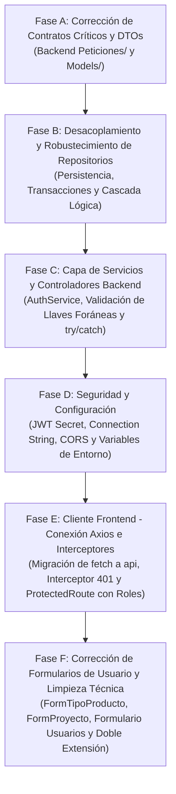

# Plan de Auditoría de Código y Cambios Arquitectónicos: Módulo Mapa de Conocimiento

> **Documento:** `PLAN_CAMBIOS.md`  
> **Fecha de Auditoría:** Octubre 2026  
> **Alcance:** Inspección estricta línea a línea de `mapa_conocimiento_api/` (Backend C#) y `Frontend/` (React SPA).  
> **Estado:** Auditoría cerrada. Ningún archivo preexistente ha sido modificado.

---

## 1. Tabla Maestra de Errores Existentes

La siguiente matriz clasifica todos los fallos detectados ordenados por nivel de severidad:
1. `1. CRÍTICA (Bloqueante / Crash)`: Imposibilidad de uso de funciones clave, fallos de compilación/ejecución o excepciones 500 no controladas.
2. `2. ALTA (Funcionalidad rota / Seguridad)`: Vulnerabilidades de seguridad, bypass de capas, pérdida de integridad referencial o desincronización de contratos.
3. `3. MEDIA (Inconsistencia / Lógica defectuosa)`: Respuestas asimétricas, contratos confusos, falta de propagación de errores o fallbacks silenciosos.
4. `4. BAJA (Deuda técnica / Convenciones)`: Advertencias de compilador, nombres de archivo incorrectos y discrepancia de dependencias.

| ID | Criticidad | Capa | Archivo(s) y Método/Línea | Descripción Técnica del Error | Impacto Real en Ejecución | Solución Exacta (Sin Silent Fallbacks) |
|---|---|---|---|---|---|---|
| **ERR-01** | `1. CRÍTICA` | Frontend / Backend | `Frontend/src/components/formularios/FormTipoProducto.jsx` (L21-25) vs `Peticiones/TipoProductoCrear.cs` (L8-23) | **Incompatibilidad absoluta de contrato:** El formulario envía `{ nombre, descripcion }`. El DTO del backend exige cuatro propiedades obligatorias marcadas con `[Required]`: `categoria`, `clase`, `nombre` y `tipologia`, y no posee el campo `descripcion`. | Al enviar el formulario, el backend siempre rechaza la petición con **HTTP 400 Bad Request** indicando que faltan `categoria`, `clase` y `tipologia`. El usuario jamás puede registrar un tipo de producto. | Reestructurar `FormTipoProducto.jsx` para capturar e ingresar `categoria`, `clase`, `nombre` y `tipologia` con sus validaciones institucionales y eliminar el campo inexistente `descripcion`. |
| **ERR-02** | `1. CRÍTICA` | Frontend / Backend | `Frontend/src/components/formularios/FormProyecto.jsx` (L5-13, L50-81) vs `Peticiones/ProyectoCrear.cs` (L21-26) | **Campos requeridos ausentes en UI:** `FormProyecto.jsx` tiene inicializado `tipo_fondos`, `fecha_inicio` y `fecha_fin` en el estado, pero **no renderiza los inputs en el JSX**. Envía `tipo_fondos: ""` y `fecha_inicio: null`. El backend exige ambos campos con `[Required]` en `ProyectoCrear.cs` y valida `!peticion.fecha_inicio.HasValue` en `ProyectoService.cs` (L25). | El endpoint responde con **HTTP 400 Bad Request** ("La fecha de inicio es obligatoria", "El campo tipo_fondos es obligatorio"). Es imposible crear proyectos desde la interfaz web. | Añadir los componentes `<InputInstitucional>` en `FormProyecto.jsx` para `tipo_fondos` (selector o texto) y selectores de fecha para `fecha_inicio` y `fecha_fin`. |
| **ERR-03** | `1. CRÍTICA` | Frontend / Backend | Los 8 archivos en `Frontend/src/components/formularios/*.jsx` (L20-37) vs `Controllers/*.cs` | **Peticiones no autenticadas en formularios:** En Fase 3 se aplicó `[Authorize]` a todos los controladores. Sin embargo, los 8 formularios siguen utilizando `fetch('http://localhost:5000/api/...')` nativo sin enviar la cabecera `Authorization: Bearer <token>`. | Cualquier intento de guardar datos desde los 8 formularios lanza **HTTP 401 Unauthorized** en la consola del navegador, dejando al usuario bloqueado aunque haya iniciado sesión con éxito. | Reemplazar todas las llamadas `fetch` por la instancia centralizada `api` importada desde `src/api/axiosConfig.js`, la cual inyecta automáticamente el token JWT mediante su interceptor. |
| **ERR-04** | `1. CRÍTICA` | Backend | `Repositories/UsuarioRepository.cs` (`ExisteUsernameOEmailAsync`, L32-36) y `Controllers/UsuarioController.cs` (L36-48) | **Crash 500 por violación de unicidad con borrado lógico:** `ExisteUsernameOEmailAsync` no usa `.IgnoreQueryFilters()`. Si un usuario fue inactivado (`activo = false`), el método retorna `false` (cree que no existe). Al intentar insertar, PostgreSQL rechaza la transacción por índice UNIQUE (`23505: unique_violation`). Como `UsuarioController` solo atrapa `ArgumentException`, la excepción `DbUpdateException` no se captura. | Se produce un **HTTP 500 Internal Server Error** no controlado en el servidor al intentar registrar un usuario o email que fue previamente borrado lógicamente. | Agregar `.IgnoreQueryFilters()` en `ExisteUsernameOEmailAsync` para detectar usuarios inactivos y lanzar un `ArgumentException("El nombre de usuario o correo ya existe en el sistema.")`. |
| **ERR-05** | `2. ALTA` | Backend (Seguridad) | `appsettings.json` (L12, L16) | **Credenciales de infraestructura y llaves criptográficas expuestas en repositorio:** La cadena de conexión a Supabase (con host, usuario y contraseña en texto plano `Au7ziQXRfe5UE4EO`) y la clave simétrica JWT (`Key`) están quemadas en el archivo versionado en Git. | Fuga crítica de seguridad. Cualquier persona con acceso de lectura al repositorio tiene control total sobre la base de datos de producción y puede firmar tokens JWT válidos arbitrarios con rol de Administrador. | Extraer las credenciales a variables de entorno o archivo de configuración local `.env` / `secrets.json`, incluir `appsettings.json` con credenciales reales en `.gitignore` y rotar inmediatamente la contraseña en Supabase y la clave JWT. |
| **ERR-06** | `2. ALTA` | Backend (Arquitectura) | `Services/AuthService.cs` (L13, L18, L25-28) | **Ruptura de la arquitectura en capas:** `AuthService` inyecta directamente `postgresContext` y realiza consultas LINQ a la base de datos saltándose la capa de repositorios. `IUsuarioRepository` no expone método de búsqueda por username con roles. | Violación del principio de responsabilidad única e inversión de dependencias. Dificulta pruebas unitarias con mocks e introduce acoplamiento directo entre el servicio y el ORM. | Declarar `Task<usuario?> ObtenerPorUsernameConRolesAsync(string username)` en `IUsuarioRepository`, implementarlo en `UsuarioRepository` con `.Include(u => u.RolesUsuario).ThenInclude(ru => ru.RolRelacionado)` e inyectar `IUsuarioRepository` en `AuthService`. |
| **ERR-07** | `2. ALTA` | Frontend (Seguridad) | `Frontend/src/components/ProtectedRoute.jsx` (L5-20) y `Frontend/src/App.jsx` (L30-40) | **Bypass de roles en rutas protegidas del cliente:** `ProtectedRoute` solo comprueba `isAuthenticated`. No recibe ni valida la lista de roles autorizados (`allowedRoles`). | Un usuario con rol "Docente" o "Consulta" puede escribir `/usuarios` en la barra del navegador y acceder a la interfaz de administración de usuarios. Aunque el backend deniega las peticiones (HTTP 403), la UI queda expuesta. | Extender `ProtectedRoute` para recibir la propiedad opcional `rolesPermitidos`. Si el rol del usuario autenticado no está en la lista, redirigir a `/dashboard` con mensaje de acceso denegado. |
| **ERR-08** | `2. ALTA` | Frontend | `Frontend/src/api/axiosConfig.js` (L8-22) y `Frontend/src/context/AuthContext.jsx` | **Ausencia de interceptor de respuesta HTTP 401/403:** No existe interceptor de respuesta en Axios para atrapar tokens expirados o revocados en caliente. | Cuando el token de 8 horas expira mientras la sesión sigue abierta en el navegador, las peticiones fallan silenciosamente o muestran errores genéricos sin forzar el logout ni redirigir a `/login`. | Implementar `api.interceptors.response.use(response => response, error => { if (error.response?.status === 401) { logout(); window.location.href = '/login'; } return Promise.reject(error); })`. |
| **ERR-09** | `2. ALTA` | Backend | `Repositories/*.cs` (`ProyectoRepository.cs` L40-48, `DocenteRepository.cs` L75-83, `AliadoRepository.cs` L62-71) | **Relaciones huérfanas por borrado lógico no propagado en cascada:** Al inactivar una entidad padre (ej. `Proyecto.activo = false`), ninguna de las tablas puente asociadas (`aliado_proyecto`, `desarrolla`, `docente_producto`, `ods_proyecto`, etc.) se inactiva. | Los registros puente quedan con `activo = true` apuntando a padres inactivos. Esto corrompe las métricas analíticas de Fase 4 y consultas multitabla (JOINs), que contarán relaciones de proyectos o docentes eliminados. | En los métodos `EliminarAsync` de las entidades padre, ejecutar la actualización lógica en cascada sobre las tablas puente asociadas dentro de la misma transacción de EF Core. |
| **ERR-10** | `2. ALTA` | Backend | `Services/UsuarioService.cs` (L64) y `Repositories/UsuarioRepository.cs` (L52-64) | **Inserción ciega de llaves foráneas en `rol_usuario`:** `UsuarioService` recibe `List<int> roles_ids` pero ni el servicio ni el repositorio validan que dichos IDs existan y estén activos en la tabla `rol`. | Si se envía un `rol_id` inexistente, PostgreSQL lanza una excepción de violación de llave foránea (`23503: foreign_key_violation`). Al no capturarse en el controlador, la API responde con **HTTP 500**. | En `UsuarioService`, validar que cada `rolId` exista en la tabla `rol` mediante un repositorio de roles o verificación previa, lanzando `ArgumentException($"El rol con ID {rolId} no existe.")`. |
| **ERR-11** | `3. MEDIA` | Backend | `Services/DocenteService.cs` (L79-82, L125-128) vs `Peticiones/DocenteCrear.cs` (L49-50) | **Silent fallback y ambigüedad de campo por error en BD:** La BD tiene la columna tipiada como `nacionalidaad`. El DTO expone `nacionalidad` y `nacionalidaad`. Si ninguno viene, `DocenteService` asigna quemado `"Colombiana"`. | Oculta errores del cliente: si el cliente omite el dato obligatorio de nacionalidad, el sistema no lo valida y le asigna arbitrariamente "Colombiana". Además confunde a los integradores de la API. | Hacer obligatorio `[Required] public required string nacionalidad { get; set; }` en el DTO, remover la propiedad duplicada `nacionalidaad` del DTO (manteniendo el mapeo `[Column("nacionalidaad")]` solo en el modelo de base de datos) y eliminar el fallback quemado `"Colombiana"`. |
| **ERR-12** | `3. MEDIA` | Backend | `Controllers/AreaConocimientoController.cs`, `AreaAplicacionController.cs`, `LineaInvestigacionController.cs`, `ObjetivoDesarrolloSostenibleController.cs`, `TipoProductoController.cs` (acciones POST y PUT) | **Ausencia de bloque try/catch en controladores Fase 1:** Estos controladores no capturan `ArgumentException` ni excepciones de validación de negocio. | Cualquier error de regla de negocio o validación de servicio no controlada por el validador de modelo genera un **HTTP 500** en vez de un **HTTP 400 Bad Request** con el mensaje descriptivo del fallo. | Agregar bloque `try { ... } catch (ArgumentException ex) { return BadRequest(new { estado = 400, mensaje = ex.Message }); }` en cada método `Crear` y `Actualizar` de estos controladores. |
| **ERR-13** | `3. MEDIA` | Backend | Todos los archivos en `Controllers/*.cs` | **Sobre-envoltorio y asimetría en respuestas HTTP:** `DocenteController` y `UsuarioController` envuelven las respuestas en `{ estado, mensaje, datos }`, mientras que `AreaConocimientoController` y `ProyectoController` retornan la entidad o DTO directo. `UsuarioController.ObtenerTodos` retorna `{ tabla, total, datos }` mientras los demás retornan un arreglo directo `[]`. | El cliente Frontend no puede estandarizar el consumo de la API, requiriendo lógica condicional dispersa (`response.data.datos || response.data`). | Estandarizar una clase genérica de respuesta `ApiResponse<T>` (`{ int estado, string mensaje, T? datos }`) o retornar directamente el DTO / arreglo con los códigos de estado HTTP nativos en todos los controladores. |
| **ERR-14** | `3. MEDIA` | Frontend | Los 8 archivos en `Frontend/src/components/formularios/*.jsx` (L48-52) | **Supresión del mensaje de error del servidor en formularios:** Los formularios capturan `!respuesta.ok` pero no leen el JSON devuelto por la API (`await respuesta.json()`). Siempre muestran el texto genérico: `"Hubo un error al guardar los datos."`. | El usuario nunca sabe por qué falló su petición (si fue por cédula duplicada, presupuesto negativo, fecha inválida o falta de permisos). | Al recibir respuesta no exitosa, extraer `error.response?.data?.mensaje || error.response?.data?.title` y desplegarlo en la etiqueta de alerta visual de la interfaz. |
| **ERR-15** | `3. MEDIA` | Frontend / Backend | `Frontend/src/pages/Dashboard.jsx` (L14-23) | **Desfase funcional de Fase 2 en UI:** El backend implementó completamente las entidades `Docente`, `Producto` y las 8 relaciones puente, pero en el frontend `Dashboard.jsx` solo contiene accesos y formularios para las 8 tablas maestras de Fase 1. | Los usuarios finales del sistema no tienen ninguna forma gráfica de registrar docentes, productos ni asociar docentes a proyectos o productos a ODS. | Crear los componentes de formulario para `Docente`, `Producto` y selectores relacionales integrándolos al menú de navegación lateral de `Dashboard.jsx`. |
| **ERR-16** | `3. MEDIA` | Frontend | `Frontend/src/api/axiosConfig.js` (L5) y formularios del frontend | **URL base del backend quemada (Hardcoding):** La dirección `'http://localhost:5000/api'` está escrita como literal de texto plano tanto en `axiosConfig.js` como en los formularios. | En el momento de compilar y desplegar a producción (Fase 4 en Vercel, Netlify o Render), la aplicación intentará conectarse a `localhost` del cliente y colapsará. | Configurar `baseURL: import.meta.env.VITE_API_URL || 'http://localhost:5000/api'` y añadir el archivo de variables de entorno `.env.example` y `.env`. |
| **ERR-17** | `3. MEDIA` | Backend (Seguridad) | `Program.cs` (L167-175) | **Política de CORS excesivamente permisiva:** La política `PermitirFrontend` utiliza `AllowAnyOrigin().AllowAnyHeader().AllowAnyMethod()`. | En entornos de producción, permite que cualquier dominio externo ejecute peticiones cross-origin arbitrarias contra la API. Si en el futuro se usan cookies o credenciales de transporte, `AllowAnyOrigin()` falla automáticamente. | Restringir los orígenes permitidos en producción leyendo los dominios autorizados desde `appsettings.json` mediante `.WithOrigins(...)`. |
| **ERR-18** | `4. BAJA` | Backend | `Peticiones/LineaInvestigacionCrear.cs.cs` | **Nombre de archivo con doble extensión:** El archivo tiene el nombre literal `LineaInvestigacionCrear.cs.cs`. | Aunque no impide la compilación de Roslyn, genera confusión en el mantenimiento y potenciales errores en herramientas de automatización CI/CD. | Renombrar el archivo a `LineaInvestigacionCrear.cs` y verificar referencias. |
| **ERR-19** | `4. BAJA` | Backend | `Models/*.cs` (`docente.cs`, `producto.cs`, `proyecto.cs`, `usuario.cs`, `rol.cs`, `aliado.cs`, `desarrolla.cs`) | **Incumplimiento de convención de nombres C# (Warning CS8981):** Clases nombradas en minúsculas para igualar nombres de PostgreSQL generan 7 advertencias de compilación `CS8981: El nombre de tipo solo contiene caracteres ASCII en minúsculas`. | Degrada la calidad del código y la observabilidad en builds limpios (`0 Warnings`). | Renombrar clases a PascalCase (`Docente`, `Producto`, `Proyecto`, `Usuario`, `Rol`, `Aliado`, `Desarrolla`) y usar el atributo `[Table("docente")]` de `System.ComponentModel.DataAnnotations.Schema`. |
| **ERR-20** | `4. BAJA` | Backend | `mapa_conocimiento_api.csproj` (L4, L11-13) | **Disparidad de versiones mayores de paquetes NuGet:** Proyecto configurado en `net10.0` con JwtBearer en `10.0.12`, pero `Microsoft.EntityFrameworkCore.Design` y `Npgsql.EntityFrameworkCore.PostgreSQL` anclados a `8.0.8`. | Riesgo potencial de incompatibilidad en tipos de dependencias compartidas y advertencias de paquetes transitivos durante la restauración en pipelines de integración continua. | Alinear las versiones de EF Core y Npgsql a una versión homogénea soportada por el SDK oficial del entorno de despliegue. |
| **ERR-21** | `4. BAJA` | Frontend | `Frontend/src/pages/PanelUsuarios.jsx` | **Panel de Usuarios incompleto (Solo Lectura):** El backend tiene listos los endpoints `POST /api/Usuario` (crear) y `DELETE /api/Usuario/{id}` (eliminar lógico), pero `PanelUsuarios.jsx` solo renderiza la tabla de consulta sin botones para registrar nuevos usuarios o desactivarlos. | Los administradores no pueden crear cuentas desde la interfaz gráfica, requiriendo usar herramientas como Swagger o Postman. | Incorporar un modal/formulario para crear usuarios asignando roles y un botón de acción en cada fila de la tabla para desactivar cuentas llamando a `DELETE /api/Usuario/{id}`. |

---

## 2. Plan de Ejecución por Fases de Corrección (Sin romper dependencias)

Para garantizar que el sistema se mantenga compilando en cada etapa y que no se rompan contratos existentes, las correcciones deben ejecutarse en el siguiente orden secuencial estricto:



---

### Fase A: Corrección de Contratos Críticos y DTOs (Backend)
*Objetivo:* Resolver la discrepancia de propiedades entre cliente y servidor antes de tocar la lógica de negocio.

1. **Renombrar archivo con doble extensión (ERR-18):**
   - Archivo: `Peticiones/LineaInvestigacionCrear.cs.cs` $\rightarrow$ renombrar a `Peticiones/LineaInvestigacionCrear.cs`.
   - Verificar que el namespace y la referencia en `LineaInvestigacionController.cs` se mantengan intactos.
2. **Corregir DTO de Docente (ERR-11):**
   - Archivo: `Peticiones/DocenteCrear.cs` y `Peticiones/DocenteEditar.cs`.
   - Cambiar `public string? nacionalidad` y `public string? nacionalidaad` por un único campo obligatorio:
     ```csharp
     [Required(ErrorMessage = "La nacionalidad es obligatoria.")]
     public required string nacionalidad { get; set; }
     ```
   - Mantener el atributo `[Column("nacionalidaad")]` en `Models/docente.cs` para no romper el mapeo con la columna física de PostgreSQL.
3. **Comprobar compilación:**
   - Ejecutar `dotnet build` para asegurar que ningún otro archivo dependa de las propiedades removidas.

---

### Fase B: Desacoplamiento y Robustecimiento de la Capa de Datos (Repositories)
*Objetivo:* Dotar a los repositorios de las consultas necesarias para respetar la arquitectura de 3 capas y garantizar integridad referencial.

1. **Extender interfaz e implementación de Usuario (ERR-06, ERR-04):**
   - Archivo: `Repositories/IUsuarioRepository.cs`:
     - Agregar firma: `Task<usuario?> ObtenerPorUsernameConRolesAsync(string username);`.
     - Agregar firma: `Task<bool> ExisteUsernameOEmailIgnorandoFiltrosAsync(string username, string email);`.
   - Archivo: `Repositories/UsuarioRepository.cs`:
     - Implementar `ObtenerPorUsernameConRolesAsync` cargando `Include(u => u.RolesUsuario).ThenInclude(ru => ru.RolRelacionado)`.
     - Implementar `ExisteUsernameOEmailIgnorandoFiltrosAsync` con `.IgnoreQueryFilters().AnyAsync(u => u.username == username || u.email == email)`.
2. **Implementar Desactivación en Cascada Lógica (ERR-09):**
   - Archivo: `Repositories/ProyectoRepository.cs`:
     - En `EliminarAsync(int id)`, antes de guardar cambios, cargar y marcar `activo = false` en `aliado_proyecto`, `desarrolla`, `docente_producto`, `ods_proyecto`, `aa_proyecto`, `ac_proyecto`, `palabras_clave`, `proyecto_linea` y `producto` que tengan dicho `proyecto_id`.
   - Archivo: `Repositories/DocenteRepository.cs`:
     - En `EliminarAsync(int cedula)`, marcar `activo = false` en las relaciones de `desarrolla` y `docente_producto` de esa cédula.
   - Archivo: `Repositories/UsuarioRepository.cs`:
     - En `EliminarAsync(int id)`, marcar `activo = false` en las relaciones de `rol_usuario` de ese usuario.

---

### Fase C: Capa de Servicios y Controladores Backend
*Objetivo:* Eliminar fallbacks silenciosos, desacoplar `AuthService` de la base de datos y controlar excepciones en controllers.

1. **Refactorizar `AuthService` (ERR-06):**
   - Archivo: `Services/AuthService.cs`.
   - Reemplazar la inyección directa de `postgresContext` por `IUsuarioRepository`.
   - En `AutenticarAsync`, invocar `await _usuarioRepository.ObtenerPorUsernameConRolesAsync(peticion.username)`.
2. **Eliminar Fallback Silencioso en `DocenteService` (ERR-11):**
   - Archivo: `Services/DocenteService.cs` (L79-82 y L125-128).
   - Eliminar el fallback `"Colombiana"`. Usar directamente `peticion.nacionalidad` validado por el DTO.
3. **Validar existencia de Roles en `UsuarioService` (ERR-10):**
   - Archivo: `Services/UsuarioService.cs`.
   - Usar `_repositorio.ExisteUsernameOEmailIgnorandoFiltrosAsync` antes de crear.
   - Inyectar verificación de que cada ID en `peticion.roles_ids` exista en la tabla de roles antes de insertar.
4. **Control de Errores con try/catch en Controladores de Fase 1 (ERR-12):**
   - Archivos:
     - `Controllers/AreaConocimientoController.cs`
     - `Controllers/AreaAplicacionController.cs`
     - `Controllers/LineaInvestigacionController.cs`
     - `Controllers/ObjetivoDesarrolloSostenibleController.cs`
     - `Controllers/TipoProductoController.cs`
   - Envolver los bloques de `Crear` y `Actualizar` en `try { ... } catch (ArgumentException ex) { return BadRequest(new { estado = 400, mensaje = ex.Message }); }`.
5. **Comprobar compilación:**
   - Ejecutar `dotnet build` verificando cero errores en el backend.

---

### Fase D: Seguridad, Configuración y Middlewares
*Objetivo:* Proteger credenciales, ajustar CORS y configurar variables de entorno.

1. **Configuración de Variables de Entorno y Secretos (ERR-05, ERR-16):**
   - Archivo: `appsettings.json`.
   - Reemplazar credenciales quemadas por placeholders o leerlas de variables de entorno de sistema (`ConnectionStrings__SupabaseConnection` y `JwtSettings__Key`).
   - Crear archivo `appsettings.Example.json` sin secretos para el repositorio.
2. **Ajuste de CORS (ERR-17):**
   - Archivo: `Program.cs`.
   - Parametrizar orígenes confiables en la política de CORS (`http://localhost:5173`, `http://localhost:3000`).
3. **Registro de Middleware de Manejo Global de Excepciones:**
   - Archivo: `Program.cs`.
   - Registrar `app.UseExceptionHandler()` para interceptar cualquier fallo 500 no previsto y retornar un JSON estructurado `{ estado = 500, mensaje = "Ocurrió un error interno en el servidor." }`.

---

### Fase E: Cliente Frontend - Conexión Centralizada e Interceptores
*Objetivo:* Asegurar que todas las peticiones viajen autenticadas y respondan a la expiración de sesión.

1. **Configurar Interceptor de Respuesta y URL de Entorno (ERR-08, ERR-16):**
   - Archivo: `Frontend/src/api/axiosConfig.js`.
   - Configurar `baseURL: import.meta.env.VITE_API_URL || 'http://localhost:5000/api'`.
   - Añadir el interceptor de respuesta para capturar error `401` y redirigir a `/login`:
     ```javascript
     api.interceptors.response.use(
       (response) => response,
       (error) => {
         if (error.response?.status === 401) {
           localStorage.removeItem('token');
           localStorage.removeItem('usuario');
           window.location.href = '/login';
         }
         return Promise.reject(error);
       }
     );
     ```
2. **Migrar los 8 Formularios de `fetch` a `api` de Axios (ERR-03, ERR-14):**
   - Archivos:
     - `Frontend/src/components/formularios/FormAreaConocimiento.jsx`
     - `Frontend/src/components/formularios/FormAreaAplicacion.jsx`
     - `Frontend/src/components/formularios/FormObjetivoDesarrolloSostenible.jsx`
     - `Frontend/src/components/formularios/FormTerminoClave.jsx`
     - `Frontend/src/components/formularios/FormLineaInvestigacion.jsx`
     - `Frontend/src/components/formularios/FormAliado.jsx`
     - `Frontend/src/components/formularios/FormProyecto.jsx`
     - `Frontend/src/components/formularios/FormTipoProducto.jsx`
   - Reemplazar `fetch(...)` por `api.post(...)`.
   - En el bloque `catch`, extraer y mostrar el mensaje del backend:
     `setMensaje({ texto: error.response?.data?.mensaje || 'Error al procesar la solicitud.', tipo: 'error' })`.
3. **Control de Roles en Enrutador Frontend (ERR-07):**
   - Archivo: `Frontend/src/components/ProtectedRoute.jsx`:
     - Añadir prop `allowedRoles = []`.
     - Validar `if (allowedRoles.length > 0 && !allowedRoles.some(r => user?.roles?.includes(r))) return <Navigate to="/dashboard" replace />;`.
   - Archivo: `Frontend/src/App.jsx`:
     - En la ruta `/usuarios`, pasar `<ProtectedRoute allowedRoles={['Administrador']}>`.

---

### Fase F: Corrección de Formularios Rotos y Completitud Funcional
*Objetivo:* Habilitar la creación real de Tipos de Producto, Proyectos y completar el Panel de Usuarios.

1. **Reconstruir `FormTipoProducto.jsx` (ERR-01):**
   - Reemplazar inputs por los 4 campos reales exigidos por Minciencias y el backend: `categoria`, `clase`, `nombre` y `tipologia`.
2. **Completar Inputs en `FormProyecto.jsx` (ERR-02):**
   - Agregar los campos `tipo_fondos`, `fecha_inicio` (selector tipo date) y `fecha_fin` (selector tipo date).
3. **Completar Funcionalidad en `PanelUsuarios.jsx` (ERR-21):**
   - Incorporar modal de creación de usuario llamando a `POST /api/Usuario` con su lista de `roles_ids`.
   - Incorporar botón de desactivación por fila llamando a `DELETE /api/Usuario/{id}`.
4. **Comprobar compilación del Frontend:**
   - Ejecutar `npm run build` dentro de `mapa_conocimiento_api/Frontend` asegurando cero errores de sintaxis y empaquetado exitoso.

