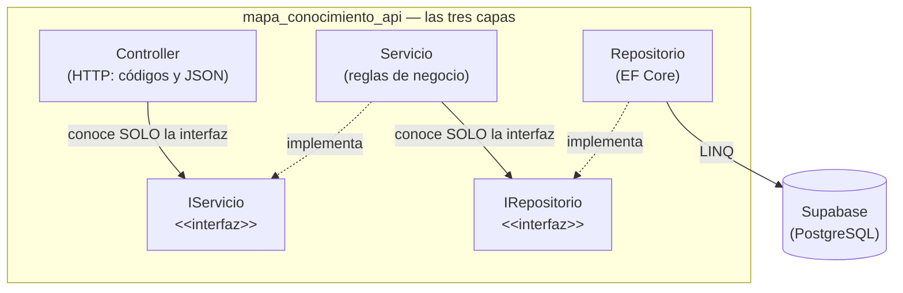

# Constitución del proyecto

> **Documento permanente.** Estas reglas rigen TODAS las fases del desarrollo del Módulo Mapa de Conocimiento. Cada fase tiene además su propia especificación; ante conflicto, la constitución gana.

---

## Artículo 1 — El proyecto es POR FASES y la especificación manda

- El sistema se construye por **fases incrementales** (Fase 0 a Fase 4), cada una con su spec kit propio y alineada al Plan de Desarrollo. Una fase está TERMINADA solo cuando pasa sus criterios de evaluación (rúbrica); entonces se hace commit, **merge a la rama principal (main)**, y solo después se pasa a la fase siguiente.
- **No se anticipa** (YAGNI): nada de endpoints con claves foráneas, seguridad JWT o integraciones complejas antes de la fase que las pida. El código de cada fase solo puede nombrar lo que su spec nombra.
- El repositorio siempre contiene la **fase en curso, funcionando**.

## Artículo 2 — Stack: C# y ASP.NET Core (Backend), React (Frontend) y Supabase

- Lenguaje **C#** sobre **ASP.NET Core** para el Proyecto API: controladores con atributos, inyección de dependencias del framework, `async/await` en todo el acceso a datos.
- **Base de Datos:** PostgreSQL alojado en **Supabase**.
- **Acceso a datos:** Dado el diseño del proyecto, se utilizará **Entity Framework Core** (EF Core). Los modelos (`Models/`) y el contexto (`postgresContext.cs`) mapean la base de datos de Supabase. LINQ reemplaza al SQL manual en el código, garantizando seguridad y parametrización automática.
- **Frontend (Decisión de Arquitectura):** Se utilizará **React** (con Vite). Es el estándar ideal para consumir APIs REST en formato JSON, manejar el estado global (tokens JWT) y construir el Dashboard de reportes (Fase 4) cumpliendo con la exigencia de un diseño responsivo.

## Artículo 3 — Arquitectura multicapa con interfaces, desde el día 1

```text
HTTP → Controller (valida la PETICIÓN del verbo)
     → IServicio              (interfaz — reglas de negocio)
     → IRepositorio           (interfaz — abstracción de datos)
     → Repositorio            (EF Core, consultas a Supabase)
     → la base de datos
```

- El controlador no toca el `DbContext`; el servicio no conoce HTTP ni la base de datos; el repositorio no conoce HTTP. Los contratos son `interface` de C#.
- **Solo el ensamblador** (la sección de registro de dependencias en `Program.cs`) conoce clases concretas. Todo lo demás recibe interfaces por constructor.
- El negocio comunica problemas con excepciones o respuestas tipadas y el controlador las traduce a HTTP.

**La regla del Artículo 3, dibujada** (las flechas son las ÚNICAS dependencias permitidas — cruzar capas o saltárselas viola la constitución):



## Artículo 4 — Separación estricta y control de versiones

- **Proyectos desacoplados:** Backend y Frontend son proyectos totalmente separados. El Frontend tiene estrictamente prohibida cualquier conexión directa a la base de datos.
- **Ramas (Branches):** Es obligatorio utilizar Git y GitHub. El desarrollo se trabaja en ramas individuales (ej. `feat/endpoints-tablas-maestras`) y se integra a la rama `main` tras validar la integración continua.

## Artículo 5 — La base de datos viene DADA y el borrado es LÓGICO

La BD `mapa_conocimiento` se crea **COMPLETA** (21 tablas) desde la Fase 0 mediante el script SQL provisto. Lo que crece por fases es la API.
- **Borrado Lógico:** Queda terminantemente prohibido el uso de sentencias `DELETE` físicas. Todo registro eliminado se marcará como inactivo (`activo = false`) para mantener la integridad histórica, implementando filtros globales en EF Core.

## Artículo 6 — Todo en español y validado por Spec Kits

- Nombres, rutas, mensajes, y documentación técnica: **en español**.
- El Frontend no inicia el desarrollo de una vista hasta que el "Spec Kit" (contrato JSON de la API) esté aprobado para evitar retrabajos de CORS o HTTP.

## Artículo 7 — Seguridad por Roles (JWT)

A partir de la Fase 3, el sistema entero queda protegido por JSON Web Tokens (JWT). El controlador validará la identidad del usuario y los Middlewares verificarán si el rol (Administrador, Consulta, Editor) tiene permisos para el endpoint solicitado.

## Artículo 8 — Convenciones fijas

| Cosa | Convención |
|---|---|
| Rutas | `/api/{tabla}` (ej. `/api/AreaConocimiento`, `/api/Proyecto`) |
| Nombres | PascalCase en C#; interfaces con prefijo `I`; respuestas en JSON usan camelCase |
| Sobre de respuesta | Lecturas: `{tabla, total, datos}` · Errores: `{estado, mensaje, detalle}` |
| Errores | Body inválido → **400/422** · Sin Token → **401** · Rol inválido → **403** · Inexistente → **404** · Fallo motor → **500** |