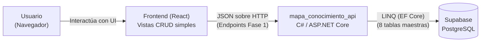

# Especificación — Fase 1: Tablas Independientes (CRUD básico)

> **Fase 1** del desarrollo incremental del Módulo Mapa de Conocimiento.
> Rige la constitución del proyecto: `1_constitucion.md`.
> En la Fase 1 el sistema construye los cimientos: **el CRUD completo para las 8 tablas maestras (sin claves foráneas)**. La base de datos ya está creada en Supabase (Fase 0).
>
> | Documento de esta versión | Contenido |
> |---|---|
> | **2_spec_fase1.md** (este) | QUÉ construir en la Fase 1 y sus criterios de aceptación |
> | `3_plan.md` | CÓMO: stack, estructura C# y diseño de las capas |
> | `6_contracts.md` | Los endpoints con formatos exactos para las tablas maestras |

---

## 1. Propósito de la Fase 1

Construir la **primera rebanada vertical** del sistema "Mapa de Conocimiento". Esta fase implementa el CRUD completo (Crear, Leer, Actualizar, Borrado Lógico) de las 8 tablas independientes tanto en el backend (C# / ASP.NET Core) como en el frontend (React), conectándose a PostgreSQL en Supabase. 

Se debe implementar la **arquitectura en capas completa desde el primer día**: controlador → servicio → repositorio, comunicados por **interfaces de C#** y usando EF Core.

**El contexto de la Fase 1 en un diagrama:**

## 2. Alcance

**Incluye:**
- CRUD completo con borrado lógico (`activo = false`) para las siguientes 8 tablas maestras:
  1. `area_conocimiento`
  2. `objetivo_desarrollo_sostenible`
  3. `area_aplicacion`
  4. `termino_clave`
  5. `linea_investigacion`
  6. `aliado`
  7. `tipo_producto`
  8. `proyecto` (no tiene FKs propias en su tabla base).
- **Modelo entidad (`Models/`)**: Las clases mapeadas para EF Core de estas 8 tablas.
- **Peticiones/DTOs**: Clases para validar los datos de entrada en el POST y PUT antes de que toquen el controlador.
- Capas con interfaces: `IRepositorio`, `IServicio`, implementadas y registradas en `Program.cs`.
- Configuración de `appsettings.json` apuntando a la URI de conexión de Supabase.
- Interfaz gráfica en React para listar, crear, editar y aplicar borrado lógico a estas 8 entidades.

**No incluye:**
- Tablas con claves foráneas (Fase 2).
- Autenticación JWT, Login y Roles (Fase 3).
- Dashboard, reportes y página corporativa (Fase 4).

## 3. Requisitos funcionales

*(Nota: Estos requisitos aplican para cada una de las 8 tablas maestras. Usaremos `{tabla}` como referencia)*.

### RF1 — Listar registros activos (GET)
`GET /api/{tabla}` → 200 con envoltura `{ "tabla": "{tabla}", "total": N, "datos": [...] }`.
- **Regla de negocio:** Solo debe devolver los registros donde `activo == true`. El filtro debe aplicarse preferiblemente de forma global en el `DbContext` de EF Core.

### RF2 — Obtener por ID (GET)
`GET /api/{tabla}/{id}` → 200 con los datos del registro.
- Inexistente o inactivo → 404.

### RF3 — Crear registro (POST)
`POST /api/{tabla}` con body validado (DTO).
- Éxito → 200 o 201 `{estado, mensaje}`.
- Body inválido → 400 o 422 con la lista de errores de validación.

### RF4 — Actualizar registro (PUT)
`PUT /api/{tabla}/{id}` con body validado (DTO).
- Éxito → 200 `{estado, mensaje}`.
- Inexistente o inactivo → 404.

### RF5 — Borrado Lógico (DELETE)
`DELETE /api/{tabla}/{id}`
- **Regla estricta:** No ejecuta `DELETE` en SQL. Debe hacer un UPDATE cambiando `activo = false`.
- Devuelve 200 `{estado, mensaje: "Registro eliminado exitosamente (lógico)"}`.
- Inexistente → 404.

## 4. Requisitos no funcionales

- **RNF1 — Capas estrictas:** El controlador no interactúa con `postgresContext`. El servicio no conoce HTTP. El repositorio se inyecta mediante interfaces.
- **RNF2 — Acceso a datos:** Uso estricto de Entity Framework Core (LINQ). Prohibido SQL concatenado a mano.
- **RNF3 — Asíncrono:** Todo acceso a BD debe ser asíncrono (`async / await`, `ToListAsync()`, `FirstOrDefaultAsync()`).
- **RNF4 — Errores uniformes:** Las respuestas de error deben seguir el formato `{ estado, mensaje, detalle }`.
- **RNF5 — Frontend aislado:** El proyecto React debe consumir los endpoints usando `fetch` o `axios`, sin conocer la base de datos directa.

## 5. Criterios de aceptación (Alineados a la Rúbrica Fase 1)

1. **Funcionalidad API REST:** Todos los endpoints (GET, POST, PUT, DELETE) para las 8 tablas responden correctamente con JSON, códigos HTTP apropiados y validan la entrada de datos.
2. **Borrado Lógico Funcional:** Ejecutar el DELETE de un registro (ej. un área de conocimiento) cambia el valor `activo` a falso en Supabase y este registro deja de aparecer en los listados GET.
3. **Funcionalidad Frontend:** La interfaz en React despliega correctamente las tablas de datos, permite abrir formularios para agregar y editar, y tiene un botón para eliminar (que consume el endpoint DELETE de la API).
4. **Separación estricta:** Se demuestra que React y ASP.NET Core operan en puertos/servidores de desarrollo distintos y se comunican solo por HTTP (sin violaciones de arquitectura).