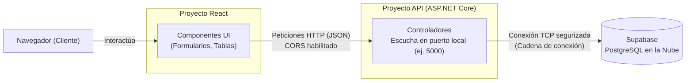
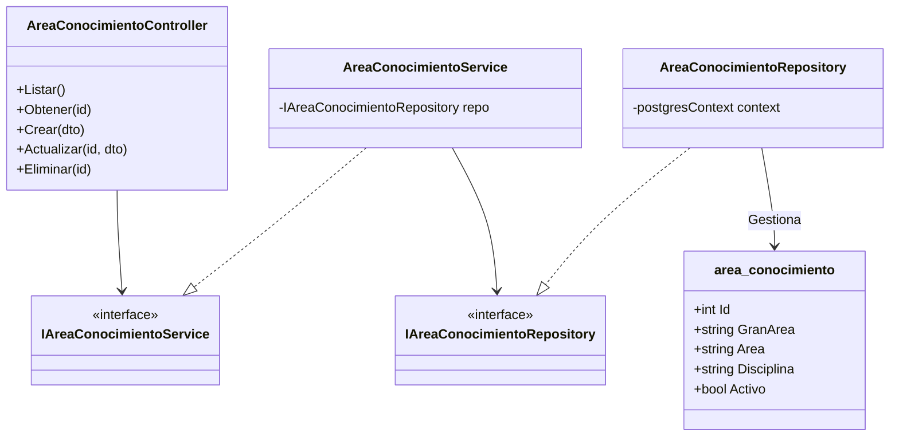

# Plan técnico — Fase 1: Tablas independientes (C# / React / Supabase)

> **Fase 1** · CÓMO construir lo especificado en `2_spec_fase1.md`.
> Este documento rige las decisiones arquitectónicas para la API Backend y la comunicación con el Frontend.

---

## 1. Stack Tecnológico

| Pieza | Elección | Por qué |
|---|---|---|
| Backend | **C# sobre ASP.NET Core** | El stack requerido. Controladores con atributos, inyección de dependencias (DI) nativa y operaciones asíncronas. |
| Acceso a datos | **Entity Framework Core (EF Core)** + `Npgsql.EntityFrameworkCore.PostgreSQL` | Permite mapear las tablas existentes en Supabase hacia objetos C#. Reemplaza el SQL manual por LINQ, aumentando la seguridad y velocidad de desarrollo. |
| Validación | **Anotaciones de datos (Data Annotations) en DTOs** | ASP.NET valida el body de la petición automáticamente (`[Required]`, `[MaxLength]`) antes de que llegue al controlador, devolviendo 400/422 si falla. |
| Base de Datos | **Supabase (PostgreSQL)** | Plataforma en la nube escalable. El motor es PostgreSQL. |
| Frontend | **React (Vite)** | Arquitectura estricta de separación (Backend/Frontend). Permite diseño responsive y un consumo eficiente de servicios REST. |

## 2. Estructura de Carpetas (Backend)

La estructura respeta el andamiaje inicial propuesto, asegurando la separación en capas lógicas:

```text
mapa_conocimiento_api/
├── appsettings.json                # Cadena de conexión a Supabase
├── Program.cs                      # ENSAMBLADOR: DI, Swagger, CORS, Middlewares
├── mapa_conocimiento_api.csproj    # Paquetes: EF Core, Npgsql, Swashbuckle
├── Controllers/
│   ├── AreaConocimientoController.cs  # Puntos de entrada HTTP para cada tabla
│   ├── ObjetivoDesarrolloSostenibleController.cs
│   └── ... (6 controladores más para la Fase 1)
├── Models/
│   ├── postgresContext.cs          # El DbContext de EF Core (Mapeo a Supabase)
│   ├── area_conocimiento.cs        # Clase entidad (mismas columnas que la BD)
│   ├── objetivo_desarrollo_sostenible.cs
│   └── ... (las demás entidades y tablas maestras)
├── Peticiones/ (Sugerida para DTOs)
│   ├── AreaConocimientoCrear.cs    # Validaciones para el POST
│   └── AreaConocimientoEditar.cs   # Validaciones para el PUT
├── Servicios/
│   ├── IAreaConocimientoService.cs # Interfaz de reglas de negocio
│   └── AreaConocimientoService.cs  # Implementación de negocio
└── Repositorios/
    ├── IAreaConocimientoRepository.cs # Interfaz de acceso a datos
    └── AreaConocimientoRepository.cs  # Implementación con EF Core (DbContext)
```

## 3. Arquitectura en capas (Flujo de una petición)

El flujo respeta la restricción de dependencias (constitución, Art. 3).

```text
HTTP → Routing (Atributos [HttpGet] / [HttpPost])
     → Validación del DTO (Automática por ASP.NET)
     → Controller (Traduce a códigos HTTP: 200, 400, 404, 500)
     → IServicio (Procesa la lógica de negocio, ignora HTTP)
     → IRepositorio (Abstracción, ignora negocio)
     → EF Core (Traduce LINQ a SQL)
     → Supabase (PostgreSQL)
```

### 3.1 Planos de Diseño (Mermaid)

**Arquitectura de Despliegue:**


**Diagrama de Clases (Ejemplo Rebanada: Area Conocimiento):**


## 4. Decisiones de diseño clave

### 4.1 Inyección de dependencias en `Program.cs`
Cada tabla maestra requerirá el registro de sus servicios y repositorios. Esto se conoce como el "Ensamblador".
```csharp
// Configuración de EF Core con Supabase
builder.Services.AddDbContext<postgresContext>(options =>
    options.UseNpgsql(builder.Configuration.GetConnectionString("SupabaseConnection")));

// Repositorios
builder.Services.AddScoped<IAreaConocimientoRepository, AreaConocimientoRepository>();
// Servicios
builder.Services.AddScoped<IAreaConocimientoService, AreaConocimientoService>();
```

### 4.2 Borrado Lógico Automático con EF Core
Dado que la especificación prohíbe el `DELETE` físico, se configurará un **Query Filter** global en `postgresContext.cs` (en el método `OnModelCreating`).
```csharp
modelBuilder.Entity<area_conocimiento>().HasQueryFilter(a => a.activo == true);
```
*Ventaja:* Al ejecutar `context.area_conocimiento.ToListAsync()`, EF Core automáticamente añade `WHERE activo = true` al SQL. Nunca se filtrarán registros borrados por accidente.

Para eliminar en el repositorio, **no** se usa `context.Remove()`. En su lugar:
```csharp
public async Task EliminarAsync(int id)
{
    var entidad = await _context.area_conocimiento.FindAsync(id);
    if (entidad != null)
    {
        entidad.activo = false; // Borrado lógico
        await _context.SaveChangesAsync();
    }
}
```

### 4.3 Validación mediante Peticiones (DTOs)
Las validaciones evitan que datos sucios lleguen a la base de datos.
```csharp
public class AreaConocimientoCrear
{
    [Required(ErrorMessage = "La gran área es obligatoria")]
    [StringLength(60)]
    public string gran_area { get; set; }
    
    // ... otros campos
}
```
Si el frontend envía un JSON inválido, ASP.NET intercepta la petición y responde un `400 Bad Request` automático con los detalles, protegiendo las capas internas.

### 4.4 Configuración de CORS
Como el Frontend (React) y la API (C#) correrán en distintos puertos durante el desarrollo, la API debe tener habilitado CORS (Cross-Origin Resource Sharing) en `Program.cs` para permitir las peticiones del navegador.
### 4.5 Traducción de excepciones a HTTP (en el controller)

El controlador (Controller) es la única capa que habla el protocolo HTTP. Su responsabilidad es capturar las respuestas del servicio o las excepciones y traducirlas al código de estado correcto:

| Situación | Código HTTP |
|---|---|
| Petición inválida (forma o tipos incorrectos, validado por DTO) | **400** (Bad Request) o **422** (Unprocessable Entity) |
| Registro no encontrado (para GET por ID, PUT, DELETE) | **404** (Not Found) |
| Éxito en lectura o actualización | **200** (OK) |
| Éxito en creación (POST) | **201** (Created) o **200** (OK) |
| Fallo en la base de datos (Supabase) o error interno | **500** (Internal Server Error) |

Cada método del controlador debe incluir un bloque `try/catch` que capture las excepciones y formatee la salida estandarizada: `{ estado, mensaje, detalle }`.

### 4.6 Base de Datos Supabase (Migración vs. Database First)

Dado que el script SQL inicial (`-- Tablas del módulo: 18...`) ya definió la estructura exacta que requiere el sistema (incluyendo los campos `activo` para el borrado lógico):

**Decisión:** Se utilizará el enfoque **Database First** asistido por Entity Framework Core.
1. La base de datos se ejecuta directamente en Supabase usando el script SQL provisto.
2. Los modelos en la carpeta `Models/` (`area_conocimiento.cs`, etc.) y el contexto `postgresContext.cs` se escriben para mapear exactamente las tablas existentes en Supabase.
3. EF Core **no** creará la base de datos ni se usarán "Migrations" en la Fase 1, ya que la infraestructura de datos se considera "dada" desde la Fase 0.

## 5. Integración Frontend (React) - Criterio estricto de separación

La constitución exige una separación estricta (Art. 4). El frontend en React consumirá la API bajo estas reglas:
- **Peticiones HTTP:** Se utilizará `fetch` nativo o la librería `axios` para todas las llamadas a la API (GET, POST, PUT, DELETE).
- **Manejo de Estado:** Se recomienda el uso de *hooks* como `useState` y `useEffect` para cargar las listas desde la API al montar el componente.
- **Variables de Entorno:** La URL base de la API (ej. `http://localhost:5000/api`) debe residir en un archivo `.env` en el proyecto React (`VITE_API_URL`), para facilitar el cambio entre desarrollo y despliegue sin tocar el código fuente.
