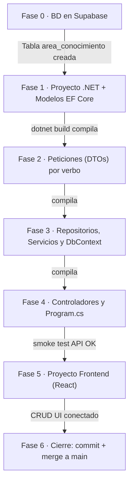

# Tareas — Fase 1: Tablas independientes (C# / React / Supabase)

> **Fase 1** · El orden de construcción, partiendo de CERO. Cada fase termina en algo **verificable**. Requisitos: `2_spec_fase1.md` · técnica: `3_plan.md` · contratos: `6_contracts.md` · validación final: `7_quickstart.md`.

---

**El orden de construcción, dibujado** — cada flecha lleva su compuerta de verificación (no se cruza en rojo).

## Fase 0 — Base de datos en Supabase
- [ ] Entrar al panel SQL de Supabase.
- [ ] Ejecutar el script provisto para crear las 21 tablas de la base de datos `mapa_conocimiento`.
- [ ] Obtener la cadena de conexión de Supabase (URI de PostgreSQL).

**Verificar:** En el panel "Table editor" de Supabase se ven las 21 tablas, incluyendo las 8 tablas maestras (ej. `area_conocimiento`, `objetivo_desarrollo_sostenible`).

## Fase 1 — El proyecto .NET y los Modelos (Entidades)
- [ ] Crear el proyecto: `mapa_conocimiento_api.csproj` (Web API de .NET).
- [ ] Instalar paquetes NuGet: `Microsoft.EntityFrameworkCore`, `Npgsql.EntityFrameworkCore.PostgreSQL`, `Swashbuckle.AspNetCore`.
- [ ] Configurar `appsettings.json` con la cadena de conexión a Supabase.
- [ ] Crear las clases en la carpeta `Models/` para las 8 tablas de la Fase 1 (ej. `area_conocimiento.cs`, `objetivo_desarrollo_sostenible.cs`). Asegurar que los tipos coincidan y que incluyan la propiedad `activo`.

**Verificar:** `dotnet build` compila sin errores.

## Fase 2 — Las peticiones (DTOs) para validación
- [ ] Crear carpeta `Peticiones/` (o usar la estructura de DTOs).
- [ ] Crear las clases para validar las entradas del POST y PUT (ej. `AreaConocimientoCrear.cs`, `AreaConocimientoEditar.cs`).
- [ ] Aplicar Data Annotations (`[Required]`, `[MaxLength]`) según las reglas de la base de datos.

**Verificar:** `dotnet build` compila sin errores.

## Fase 3 — Contexto de datos, Repositorios y Servicios
- [ ] En `Models/`, crear `postgresContext.cs` heredando de `DbContext`. Configurar los `DbSet` para las 8 tablas maestras y aplicar el **Global Query Filter** para el borrado lógico en `OnModelCreating` (`HasQueryFilter(x => x.activo)`).
- [ ] En `Repositories/`, crear las interfaces y clases para las 8 tablas (ej. `IAreaConocimientoRepository.cs` y `AreaConocimientoRepository.cs`). Usar LINQ y métodos asíncronos. El método de eliminar debe hacer `entidad.activo = false`.
- [ ] En `Services/`, crear las interfaces y clases (ej. `IAreaConocimientoService.cs` y `AreaConocimientoService.cs`) implementando las reglas de negocio.

**Verificar:** `dotnet build` compila sin errores.

## Fase 4 — Controladores y Ensamblador (Program.cs)
- [ ] En `Controllers/`, crear los 8 controladores (ej. `AreaConocimientoController.cs`). Usar atributos de ruta, verbos (GET, POST, PUT, DELETE) y el bloque try/catch para los códigos HTTP.
- [ ] En `Program.cs`, registrar el DbContext usando la cadena de conexión de `appsettings.json`.
- [ ] En `Program.cs`, registrar todos los repositorios y servicios con `AddScoped`.
- [ ] Configurar CORS en `Program.cs` para permitir peticiones desde el frontend (ej. `localhost:5173`).

**Verificar:** Correr `dotnet watch`. Abrir Swagger (`http://localhost:5000/swagger`) y probar crear, listar y eliminar lógicamente un registro en Supabase.

## Fase 5 — Proyecto Frontend (React)
- [ ] Crear el proyecto frontend (ej. `npm create vite@latest mapa_conocimiento_client -- --template react`).
- [ ] Configurar variables de entorno (`.env`) con la URL de la API.
- [ ] Crear componentes para listar (Tablas) y gestionar (Formularios) las 8 entidades maestras.
- [ ] Implementar el consumo de los endpoints usando `fetch` o `axios` respetando el formato JSON de los contratos.

**Verificar:** Ejecutar `npm run dev`. Navegar por las vistas en el navegador, crear un registro desde la UI de React y verificar que aparece en Supabase.

## Fase 6 — Cierre de la fase
- [ ] Correr el smoke test completo de `7_quickstart.md` verificando los endpoints y el frontend.
- [ ] Asegurarse de que no se usó ninguna tabla con llaves foráneas (`docente`, `proyecto`, etc.).
- [ ] Hacer commit de los cambios en las ramas respectivas.
- [ ] Integrar (Merge) a la rama `main`.

**La Fase 1 está TERMINADA.** Solo ahora se revisa la especificación de la Fase 2.
