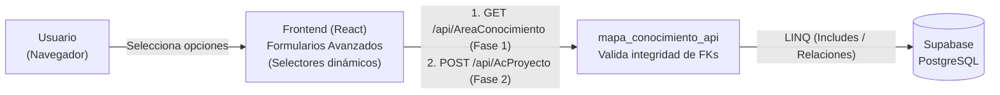

# Especificación — Fase 2: Integridad Referencial y Relaciones

> **Fase 2** del desarrollo incremental del Módulo Mapa de Conocimiento.
> Rige la constitución del proyecto: `1_constitucion.md`.
> En la Fase 2, el sistema crece sobre los cimientos de la Fase 1. Se implementa el **CRUD para las 10 tablas restantes que poseen dependencias (Claves Foráneas - FK)**. 
>
> | Documento de esta fase | Contenido |
> |---|---|
> | **2_spec_fase2.md** (este) | QUÉ construir en la Fase 2 y sus criterios de aceptación |
> | `3_plan_fase2.md` | CÓMO: manejo de relaciones en EF Core y carga dinámica en React |
> | `6_contracts_fase2.md` | Contratos exactos para endpoints relacionales |
> | `8_tasks_fase2.md` | Orden de construcción por tareas |

---

## 1. Propósito de la Fase 2

Construir la segunda rebanada del sistema. Esta fase habilita el núcleo transaccional del módulo, permitiendo vincular la información. El backend debe garantizar que no se puedan crear registros huérfanos (validación de integridad referencial), y el frontend debe evolucionar para que el usuario no escriba IDs a mano, sino que seleccione opciones desde listas desplegables (selects) dinámicas pobladas por los endpoints de la Fase 1.

**El contexto de la Fase 2 en un diagrama:**

## 2. Alcance

**Incluye:**
- CRUD completo con borrado lógico (`activo = false`) para las 10 tablas relacionales:
  1. `docente` (FK hacia `linea_investigacion`)
  2. `producto` (FK hacia `proyecto` y `tipo_producto`)
  3. `aliado_proyecto` (Tabla puente)
  4. `desarrolla` (Tabla puente docente-proyecto con campos extra)
  5. `palabras_clave` (Tabla puente)
  6. `ac_proyecto` (Tabla puente)
  7. `proyecto_linea` (Tabla puente)
  8. `ods_proyecto` (Tabla puente)
  9. `aa_proyecto` (Tabla puente)
  10. `docente_producto` (Tabla puente)
- **Modelos y Navegación EF Core:** Configuración de las propiedades de navegación (`virtual ICollection`, etc.) en el `postgresContext`.
- **DTOs Avanzados:** Peticiones que incluyan los IDs de las llaves foráneas. Las lecturas (GET) deben devolver objetos anidados (la información de la relación) y no solo el número de ID.
- **Frontend (React):** Formularios con componentes `<select>` que hacen peticiones HTTP asíncronas para cargar sus `options`.

**No incluye:**
- Autenticación JWT, Login y Roles (Fase 3).
- Dashboard analítico y consultas multitabla complejas para métricas (Fase 4).

## 3. Requisitos funcionales

*(Usaremos `{tabla}` como referencia para cualquiera de las 10 tablas de esta fase)*.

### RF1 — Listar registros con datos relacionados (GET)
`GET /api/{tabla}` → 200 con envoltura `{ "tabla": "{tabla}", "total": N, "datos": [...] }`.
- **Regla de negocio:** El JSON devuelto debe incluir los datos de la tabla padre (ej. al pedir `producto`, debe venir el nombre del `tipo_producto`, no solo su `id`). Esto requiere el uso de `.Include()` en EF Core.
- Solo debe devolver registros donde `activo == true`.

### RF2 — Crear registro validando FKs (POST)
`POST /api/{tabla}` con body validado.
- Si el ID de la clave foránea enviado no existe en la base de datos o está inactivo, el sistema debe rechazar la petición con un `400 Bad Request` (Violación de Integridad Referencial de Negocio).
- Éxito → 201 `{estado, mensaje}`.

### RF3 — Actualizar relaciones (PUT)
`PUT /api/{tabla}/{id}` con body validado.
- Aplican las mismas validaciones de existencia de FK que en el POST.
- En las **tablas puente** (ej. `ac_proyecto` donde la PK es compuesta por `proyecto_id` y `area_conocimiento_id`), la actualización generalmente implica borrar lógicamente la relación anterior y crear una nueva, o simplemente un DELETE (borrado lógico) y POST nuevo, según se defina en el contrato.

### RF4 — Borrado Lógico en Cascada (DELETE)
`DELETE /api/{tabla}/{id}`
- Cambia `activo = false`.
- **Regla de negocio:** Si se borra un `proyecto` (Fase 1), el sistema NO borra físicamente sus relaciones en `ac_proyecto`, sino que debe manejar el estado de inactividad de forma coherente en el frontend, o bien la API debe invalidar la cascada marcando las relaciones también en falso (opcional según el diseño del servicio). Para esta fase, basta con el borrado lógico individual de la entidad puente.

## 4. Requisitos no funcionales

- **RNF1 — Carga ansiosa (Eager Loading):** Prohibido el problema N+1. Las consultas de EF Core deben usar `.Include()` y `.Select()` para traer la data relacional en un solo viaje a Supabase.
- **RNF2 — Selectores React:** El componente de React no debe quemar (hardcode) las opciones del `<select>`. Debe existir un `useEffect` que llame a la API de la tabla maestra al montar el componente.

## 5. Criterios de aceptación (Rúbrica Fase 2)

1. **Integridad Referencial Demostrada:** Se intenta crear un `producto` apuntando a un `tipo_producto` ID 9999 (inexistente) y la API lo bloquea con un HTTP 400 limpio, sin reventar el servidor (no hay HTTP 500 por error de motor SQL).
2. **Selectores Dinámicos:** En el Frontend, al crear un `docente`, el campo "Línea de investigación principal" es un desplegable poblado automáticamente con los datos reales provenientes de la API de Fase 1.
3. **JSON Anidado:** El endpoint GET de `docente` retorna la cédula, nombres y un objeto/string anidado con el nombre de su línea de investigación, en lugar de retornar únicamente el número entero de la FK.