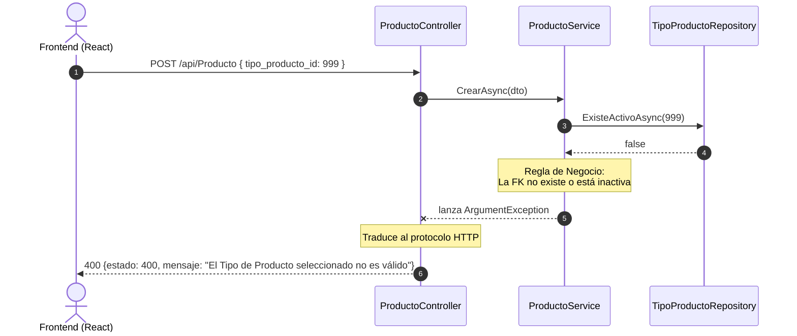

# Contratos HTTP — Fase 2: Endpoints para tablas con relaciones

> **Fase 2** · Base local (Ejemplo): `http://localhost:5000`. Estos contratos definen la comunicación estricta entre el Frontend (React) y la API para las 10 tablas que poseen llaves foráneas (FK). Se exige el uso de **Response DTOs** para aplanar los datos y evitar ciclos de referencia.

---

## 0. Convenciones globales

- **Envoltura y Errores:** Se mantienen las convenciones de la Fase 1 (`{ tabla, total, datos }` para GET múltiple y `{ estado, mensaje, detalle }` para errores).
- **Relaciones en GET (Eager Loading):** Los endpoints GET no deben devolver únicamente el ID numérico de la relación. Deben devolver un objeto anidado o un string representativo (ej. el nombre de la línea de investigación) para que React pueda mostrarlo al usuario sin hacer peticiones adicionales.
- **Relaciones en POST/PUT:** El Frontend (React) enviará únicamente el **ID** de la llave foránea capturado desde el componente `<select>`.

| Situación | Código HTTP |
|---|---|
| ID de Llave Foránea no existe o está inactivo | **400** (Bad Request) por violación de negocio |
| Body inválido (Faltan campos) | **400** o **422** |
| Registro no encontrado (GET por ID, PUT, DELETE) | **404** (Not Found) |

## 0.1 Secuencia de un Error 400 (Violación de Integridad Referencial)

Cuando React intenta crear un registro apuntando a un ID foráneo que no existe (ej. un `tipo_producto` inválido).



## 1. `GET /api/{Entidad Fuerte}` — Listar con Eager Loading

*Ejemplo para `Docente` (depende de `linea_investigacion`).*

```http
GET /api/Docente
```
**Respuesta (200 OK):**
```json
{
  "tabla": "docente",
  "total": 1,
  "datos": [
    {
      "cedula": 10102020,
      "nombres": "Camilo Alejandro",
      "apellidos": "Munevar",
      "correo": "camilo@universidad.edu.co",
      "activo": true,
      "linea_investigacion": {
        "id": 5,
        "nombre": "Inteligencia Artificial"
      }
    }
  ]
}
```
*(Nota: El objeto anidado `linea_investigacion` es generado por un DTO de respuesta en la capa de Servicios, leyendo la propiedad de navegación `Include(d => d.LineaInvestigacionRelacionada)`).*

## 2. `POST /api/{Entidad Fuerte}` — Crear Registro con FK

*Ejemplo para `Producto`.*
El body enviado desde React solo contiene los IDs nativos de las opciones seleccionadas en el `<select>`.

```http
POST /api/Producto
Content-Type: application/json

{
  "nombre": "Algoritmo de predicción MOBA",
  "categoria": "Software",
  "fecha_entrega": "2026-05-15",
  "proyecto_id": 10,
  "tipo_producto_id": 2
}
```

**Respuesta Exitosa (201 Created):**
```json
{
  "estado": 201,
  "mensaje": "Producto creado exitosamente."
}
```

## 3. Manejo de Tablas Puente (Relación Muchos a Muchos)

Las tablas puente (ej. `ac_proyecto`, `desarrolla`) vinculan dos entidades. El identificador en la ruta suele ser compuesto o se maneja a nivel de la entidad padre.

### Ejemplo: Asignar un docente a un proyecto (Tabla `desarrolla`)

Esta tabla tiene campos extra (`rol`, `descripcion`), por lo que su endpoint POST debe recibirlos.

```http
POST /api/Desarrolla
Content-Type: application/json

{
  "docente_cedula": 10102020,
  "proyecto_id": 10,
  "rol": "Investigador Principal",
  "descripcion": "Encargado de la arquitectura backend."
}
```

**Respuesta Exitosa (200 OK):**
```json
{
  "estado": 200,
  "mensaje": "Docente asignado al proyecto exitosamente."
}
```

### Ejemplo: Borrado Lógico de una Tabla Puente

Para eliminar la relación anterior, la API requiere ambos IDs. Usaremos query parameters o una ruta compuesta.

```http
DELETE /api/Desarrolla?docenteCedula=10102020&proyectoId=10
```

**Respuesta Exitosa (200 OK):**
```json
{
  "estado": 200,
  "mensaje": "Relación eliminada exitosamente (borrado lógico)."
}
```
*(Nota: En Supabase, el registro en la tabla `desarrolla` pasará a `activo = false`).*

## 4. Obtener Selectores para el Frontend (React)

Para que React pueda armar sus listas desplegables (`<select>`), consumirá directamente los endpoints de la Fase 1. 

Por ejemplo, al montar el formulario de "Crear Producto", React hará un `GET /api/Proyecto` y un `GET /api/TipoProducto`. El frontend se encargará de extraer el `id` (para el `<option value="...">`) y el `nombre` (para el texto visible) del JSON retornado.