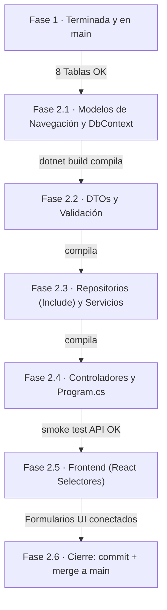

# Tareas — Fase 2: Integridad Referencial y Relaciones

> **Fase 2** · El orden de construcción para las 10 tablas relacionales. Cada paso termina en algo **verificable**. Requisitos: `2_spec_fase2.md` · técnica: `3_plan_fase2.md` · contratos: `6_contracts_fase2.md` · validación final: `7_quickstart_fase2.md`.

---

**El orden de construcción, dibujado** — cada flecha lleva su compuerta de verificación (no se cruza en rojo).

## Fase 2.1 — Modelos de Navegación y DbContext
- [ ] En `Models/`, crear las clases para las 10 tablas relacionales (ej. `docente.cs`, `producto.cs`, `ac_proyecto.cs`).
- [ ] Agregar las **propiedades de navegación virtuales** en estas clases (ej. `public virtual proyecto ProyectoRelacionado { get; set; }`).
- [ ] En `postgresContext.cs`, agregar los `DbSet` para estas 10 tablas.
- [ ] En `postgresContext.cs` (`OnModelCreating`), configurar las **llaves primarias compuestas** para las 8 tablas puente (ej. `HasKey(x => new { x.proyecto, x.area_conocimiento })`).
- [ ] En `postgresContext.cs`, aplicar el **Global Query Filter** de borrado lógico (`HasQueryFilter(x => x.activo)`) a las 10 tablas nuevas.

**Verificar:** `dotnet build` compila sin errores.

## Fase 2.2 — Peticiones (DTOs) y Validación
- [ ] En `Peticiones/`, crear las clases DTO de entrada para los POST/PUT (ej. `ProductoCrear.cs`, `DesarrollaCrear.cs`).
- [ ] En `Peticiones/`, crear **Response DTOs** (opcional pero recomendado) para aplanar la salida de los GET y evitar JSON circulares masivos.
- [ ] Aplicar Data Annotations asegurando que los IDs de llaves foráneas sean requeridos.

**Verificar:** `dotnet build` compila sin errores.

## Fase 2.3 — Repositorios y Servicios (Integridad)
- [ ] En `Repositories/`, crear las interfaces y clases para las 10 tablas.
- [ ] En los métodos de lectura (`ObtenerTodosAsync`, `ObtenerPorIdAsync`), agregar `.Include()` para traer los datos relacionales (Eager Loading) requeridos por el contrato.
- [ ] En `Services/`, crear la lógica de negocio. En los métodos de `Crear` y `Actualizar`, agregar la validación explícita: consultar si la llave foránea existe y está activa ANTES de guardar. Si no, lanzar excepción (ej. `ArgumentException`) para que el controlador devuelva `400`.
- [ ] Para los métodos de `Eliminar` en tablas puente, asegurar que se haga un UPDATE a `activo = false` enviando ambas llaves de la PK compuesta.

**Verificar:** `dotnet build` compila sin errores.

## Fase 2.4 — Controladores y Configuración (Program.cs)
- [ ] En `Controllers/`, crear los 10 controladores (ej. `ProductoController`, `DesarrollaController`). Usar atributos de ruta y capturar la `ArgumentException` para devolver un `400 Bad Request`.
- [ ] En `Program.cs`, registrar los nuevos repositorios y servicios con `AddScoped`.
- [ ] En `Program.cs`, configurar `ReferenceHandler.IgnoreCycles` en las opciones de JSON de los controladores (como red de seguridad).

**Verificar:** Ejecutar `dotnet watch`. Probar con Swagger crear un registro con una FK inválida y verificar que retorna `400`. Probar un GET y verificar que trae el objeto anidado (Include).

## Fase 2.5 — Frontend (React: Selectores Dinámicos)
- [ ] En React, crear los componentes de formulario para las nuevas tablas (ej. `FormularioProducto.jsx`).
- [ ] Implementar `useEffect` para llamar a los endpoints de la Fase 1 (`GET /api/TipoProducto`, `GET /api/Proyecto`) al montar el componente.
- [ ] Guardar las respuestas en estados (`useState`) y renderizar etiquetas `<select>` donde cada `<option>` tenga como `value` el ID y como texto visible el nombre.
- [ ] Implementar el envío (submit) del formulario asegurando que los IDs seleccionados se envíen como números (y no como strings) según el contrato JSON.

**Verificar:** Ejecutar `npm run dev`. Navegar a la vista de crear producto, verificar que el desplegable muestra datos reales de la BD, seleccionar uno, guardar, y confirmar que se refleja en Supabase.

## Fase 2.6 — Cierre de la Fase 2
- [ ] Correr el smoke test completo de `7_quickstart_fase2.md`.
- [ ] Asegurarse de que el frontend no muestra IDs "pelados" en las tablas de datos, sino los nombres relacionados.
- [ ] Hacer commit de los cambios en las ramas respectivas.
- [ ] Integrar (Merge) a la rama `main`.

**La Fase 2 está TERMINADA.** Solo ahora el equipo está listo para abordar la seguridad, autenticación (JWT) y manejo de usuarios en la Fase 3.