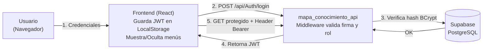

# Especificación — Fase 3: Seguridad, Autenticación y Usuarios

> **Fase 3** del desarrollo incremental del Módulo Mapa de Conocimiento.
> Rige la constitución del proyecto: `1_constitucion.md`.
> En la Fase 3, el sistema deja de ser público. Se implementa el **Módulo de Gestión de Usuarios**, la autenticación basada en tokens (JWT) y la autorización basada en roles (RBAC).
>
> | Documento de esta fase | Contenido |
> |---|---|
> | **2_spec_fase3.md** (este) | QUÉ construir en la Fase 3 y sus criterios de aceptación |
> | `3_plan_fase3.md` | CÓMO: Configuración JWT en .NET y manejo de sesión en React |
> | `6_contracts_fase3.md` | Contratos exactos para Login y gestión de usuarios |
> | `8_tasks_fase3.md` | Orden de construcción por tareas |

---

## 1. Propósito de la Fase 3

Bloquear el aplicativo mediante seguridad robusta. La API pasará a rechazar peticiones anónimas (excepto el Login) exigiendo un Token Bearer. El frontend (React) obligará a los usuarios a iniciar sesión antes de mostrar el contenido. Además, se habilitará un panel exclusivo para que el perfil de "Administrador" gestione las cuentas de usuario y los asigne a roles específicos.

**El contexto de la Fase 3 en un diagrama:**

## 2. Alcance

**Incluye:**
- **Tablas de Gestión de Usuarios:** CRUD completo para las 3 tablas restantes: `usuario`, `rol` y `rol_usuario`.
- **Endpoint de Login:** Endpoint POST público que recibe usuario y contraseña, valida el hash (ej. con BCrypt) y retorna un JSON Web Token (JWT).
- **Middlewares de Seguridad (Backend):** 
  - *Autenticación:* Verificar que la petición HTTP traiga un JWT válido en la cabecera (Header).
  - *Autorización:* Verificar que el rol del usuario (embebido en el Payload del JWT) le permita ejecutar la acción solicitada.
- **Seguridad en Frontend (React):**
  - Página de inicio de sesión (Login UI).
  - Almacenamiento seguro del token.
  - Interceptores HTTP (Axios/Fetch) para inyectar el token automáticamente en cada petición a la API.
  - Rutas privadas y Menú dinámico según los roles del usuario.

**No incluye:**
- Registro público de usuarios (los crea únicamente el administrador).
- Dashboard analítico ni identidad corporativa pública (Fase 4).
- Recuperación de contraseña por correo electrónico (Fuera del alcance académico actual).

## 3. Requisitos funcionales

### RF1 — Autenticación (Login)
`POST /api/Auth/login`
- Recibe nombre de usuario y contraseña plana.
- Debe encriptar la contraseña para compararla con el hash almacenado en Supabase.
- Si es válido, genera y devuelve un JWT firmado con una clave secreta del servidor, con una vigencia de 8 horas. Retorna además el listado de roles del usuario.
- Si falla, retorna `401 Unauthorized`.

### RF2 — Panel de Gestión de Usuarios (CRUD Administrativo)
`GET, POST, PUT, DELETE /api/Usuario` y `/api/Rol`
- Solo un usuario con rol "Administrador" puede consumir estos endpoints.
- Un usuario normal (Consulta o Editor) que intente acceder recibirá un `403 Forbidden`.
- Al crear un usuario, el backend debe encriptar la contraseña automáticamente. No se guardan contraseñas en texto plano bajo ninguna circunstancia.

### RF3 — Autorización en Tablas del Módulo
- Todas las tablas de la Fase 1 y 2 quedan bloqueadas (`[Authorize]`).
- Rol **Consulta**: Solo puede hacer peticiones GET a los endpoints.
- Rol **Editor**: Puede hacer GET, POST y PUT. No puede hacer DELETE (borrado lógico).
- Rol **Administrador**: Acceso total (CRUD completo).

### RF4 — Experiencia de Usuario (Frontend)
- Si un usuario entra directamente a `/proyectos` sin estar autenticado, React debe redireccionarlo forzosamente a la pantalla de `/login`.
- Botón de "Cerrar sesión" que destruye el token local y limpia los estados.

## 4. Requisitos no funcionales

- **RNF1 — Cifrado:** Uso estricto de librerías de Hash asimétrico (como BCrypt.Net-Next) para las contraseñas.
- **RNF2 — JWT Stateless:** La API de C# no debe guardar la "sesión" en memoria o base de datos. Toda la validación se hace verificando la firma matemática del JWT.
- **RNF3 — Protección JWT:** El JWT debe incluir claims (datos) para el `sub` (ID de usuario) y `roles`, pero jamás contener información sensible como la contraseña.

## 5. Criterios de aceptación (Rúbrica Fase 3)

1. **Bloqueo API Demostrado:** Hacer un GET vía Swagger o cURL a `/api/AreaConocimiento` sin token devuelve un error `401 Unauthorized`.
2. **Login Exitoso:** Enviar credenciales válidas a `/api/Auth/login` devuelve un JWT válido decodificable en *jwt.io* que contiene los roles del usuario.
3. **Control de Acceso Frontend:** Un usuario con rol "Consulta" se loguea y el menú lateral oculta la sección "Gestión de Usuarios". Además, si intenta inyectar una petición POST manual desde consola, la API le responde `403 Forbidden`.
4. **Hashes Seguros:** Un vistazo a la tabla `usuario` en Supabase revela que todas las contraseñas son cadenas irreconocibles generadas por BCrypt, no textos planos.