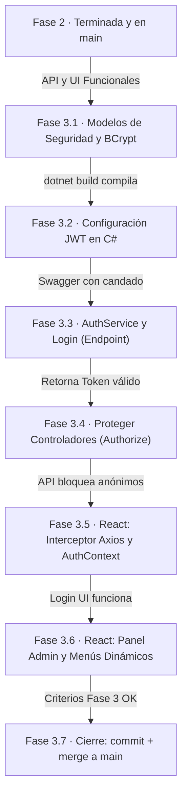

# Tareas — Fase 3: Seguridad, Autenticación y Roles

> **Fase 3** · El orden de construcción para blindar la aplicación. Cada paso termina en algo **verificable**. Requisitos: `2_spec_fase3.md` · técnica: `3_plan_fase3.md` · contratos: `6_contracts_fase3.md` · datos: `5_data_model_fase3.md`.

---

**El orden de construcción, dibujado** — cada flecha lleva su compuerta de verificación (no se cruza en rojo).

## Fase 3.1 — Modelos de Seguridad y Hashing (BCrypt)
- [ ] En `Models/`, crear las clases para `usuario.cs`, `rol.cs` y `rol_usuario.cs` con sus propiedades de navegación.
- [ ] En `postgresContext.cs`, configurar los `DbSet`, las llaves compuestas, las restricciones UNIQUE y los filtros de borrado lógico para estas tres tablas.
- [ ] Instalar el paquete NuGet `BCrypt.Net-Next` en el proyecto backend.
- [ ] Entrar al panel SQL de Supabase y hacer un "Seeding" manual: insertar el rol "Administrador" y crear un usuario inicial "admin" generando un hash de BCrypt válido desde alguna herramienta externa.

**Verificar:** `dotnet build` compila sin errores. El usuario 'admin' existe en Supabase.

## Fase 3.2 — Configuración JWT en C# (Program.cs)
- [ ] Instalar el paquete NuGet `Microsoft.AspNetCore.Authentication.JwtBearer`.
- [ ] En `appsettings.json`, agregar la sección `JwtSettings` con una clave secreta fuerte (`Key`), `Issuer` y `Audience`.
- [ ] En `Program.cs`, agregar el servicio de autenticación (`AddAuthentication(JwtBearerDefaults.AuthenticationScheme).AddJwtBearer(...)`) validando la firma (IssuerSigningKey).
- [ ] En `Program.cs`, asegurarse de agregar `app.UseAuthentication()` justo antes de `app.UseAuthorization()`.
- [ ] *(Opcional pero recomendado)* Configurar Swagger en `Program.cs` para que acepte el token Bearer (el "candado" en la UI de Swagger).

**Verificar:** La API sigue levantando sin errores.

## Fase 3.3 — AuthService y Endpoint de Login
- [ ] En `Peticiones/`, crear `LoginRequest.cs` (DTO con username y password).
- [ ] En `Services/`, crear `AuthService.cs`. Implementar el método de Login: buscar al usuario en BD, validar la contraseña con `BCrypt.Verify`, y generar el token usando `JwtSecurityTokenHandler` con los *Claims* de Rol.
- [ ] En `Controllers/`, crear `AuthController.cs` con el endpoint `[HttpPost("login")]` que consuma el servicio y devuelva el JWT al cliente.

**Verificar:** Enviar credenciales válidas por Swagger o cURL a `/api/Auth/login` devuelve un 200 OK con el token. Enviar una mala contraseña devuelve 401.

## Fase 3.4 — Proteger Controladores y CRUD de Usuarios
- [ ] Ir a los controladores de la Fase 1 y Fase 2 (ej. `AreaConocimientoController`, `ProyectoController`) y agregar el decorador `[Authorize]`.
- [ ] Crear el `UsuarioController` para el CRUD administrativo. Protegerlo estrictamente con `[Authorize(Roles = "Administrador")]`.
- [ ] En el `UsuarioService`, al momento de crear un usuario nuevo, asegurar que la contraseña se encripte usando `BCrypt.HashPassword` antes de guardar en base de datos.

**Verificar:** Intentar hacer un `GET /api/AreaConocimiento` sin token ahora devuelve un error `401 Unauthorized`.

## Fase 3.5 — Frontend (React): AuthContext e Interceptores
- [ ] Instalar la librería `jwt-decode` en el frontend (`npm install jwt-decode`).
- [ ] Crear una instancia global de Axios (o Fetch custom) que intercepte todas las peticiones (Interceptor) e inyecte el `localStorage.getItem('token')` en el header `Authorization`.
- [ ] Crear un contexto global en React (`AuthContext.jsx`) para manejar el estado `{ isAuthenticated, user }`.
- [ ] Crear la vista `Login.jsx` (Pantalla de inicio de sesión). Al hacer submit, llamar a la API, guardar el token en localStorage, decodificar el token para sacar el nombre y el rol, actualizar el Contexto y redirigir al Dashboard o Lista de Proyectos.

**Verificar:** El login en la web de React funciona. Al navegar a otras vistas, las peticiones HTTP (Network del navegador) llevan el header `Authorization: Bearer ...` y la API responde con 200 OK.

## Fase 3.6 — Frontend (React): Panel Admin y Menús Dinámicos
- [ ] Implementar un componente de rutas protegidas (ej. `<ProtectedRoute>`) para evitar que usuarios no logueados entren escribiendo la URL manual. Redirigir a `/login`.
- [ ] Modificar el Navbar o Sidebar para que lea el rol del usuario desde el `AuthContext`.
- [ ] Ocultar el enlace "Gestión de Usuarios" si el usuario no tiene el rol "Administrador".
- [ ] Crear la vista para el CRUD de Usuarios (solo accesible para administradores), permitiendo crear cuentas y asignarles roles.

**Verificar:** Entrar con una cuenta "Consulta" y confirmar que no hay forma de navegar a la gestión de usuarios.

## Fase 3.7 — Cierre de la Fase 3
- [ ] Ejecutar pruebas de regresión: Asegurar que todo lo que funcionaba en la Fase 1 y Fase 2 sigue funcionando, pero ahora requiriendo el token.
- [ ] Hacer commit de los cambios en las ramas respectivas.
- [ ] Integrar (Merge) a la rama `main`.

**La Fase 3 está TERMINADA.** El sistema ahora es seguro. Solo queda la Fase 4 para la analítica, reportes y el despliegue final en la nube.