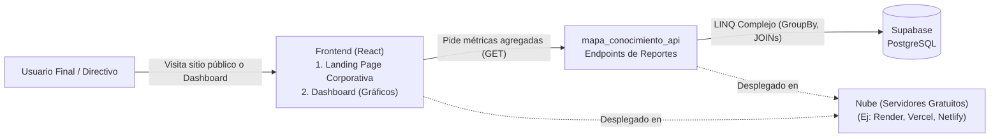

# Especificación — Fase 4: Analítica, Identidad Corporativa y Despliegue

> **Fase 4** del desarrollo incremental del Módulo Mapa de Conocimiento.
> Rige la constitución del proyecto: `1_constitucion.md`.
> Esta es la fase final (Cierre). El sistema expone su potencial analítico a través de **consultas multitabla complejas** que alimentan un **Dashboard**, se reviste de una **identidad corporativa** para el usuario final, y se **publica en la nube**.
>
> | Documento de esta fase | Contenido |
> |---|---|
> | **2_spec_fase4.md** (este) | QUÉ construir en la Fase 4 y sus criterios de aceptación |
> | `3_plan_fase4.md` | CÓMO: Arquitectura de reportes en EF Core, diseño web y despliegue |
> | `4_research_fase4.md` | Decisiones y alternativas sobre servidores gratuitos y analítica |
> | `5_data_model_fase4.md` | Visión general del modelo de datos unificado para las consultas |
> | `6_contracts_fase4.md` | Contratos exactos para los endpoints del Dashboard |
> | `7_quickstart_fase4.md` | Guía de arranque y pruebas del aplicativo completo |
> | `8_tasks_fase4.md` | Orden de construcción y despliegue por tareas |

---

## 1. Propósito de la Fase 4

El objetivo principal es transformar los datos transaccionales (Fases 1 y 2) en **información estratégica**. La API debe ejecutar sentencias complejas (JOINs) para generar métricas institucionales. El Frontend (React) debe consumir estas métricas y presentarlas gráficamente en un Panel de Control (Dashboard). Además, el Frontend debe ofrecer una "cara pública" (Landing Page corporativa) antes de solicitar el Login. Finalmente, todo el aplicativo (Backend, Frontend y BD) debe estar accesible en la red mediante un despliegue gratuito.

**El contexto de la Fase 4 en un diagrama:**

## 2. Alcance

**Incluye:**
- **Backend (API Analítica):** Creación de al menos **10 consultas multitabla complejas** (mínimo 4 tablas involucradas por consulta) expuestas como endpoints dedicados (ej. `/api/Reportes/...`).
- **Frontend (Área Pública):** Diseño responsivo de 5 páginas corporativas:
  1. *Inicio (Home):* Propuesta de valor y CTA.
  2. *Nosotros:* Historia, equipo y filosofía.
  3. *Servicios:* Qué ofrece el módulo.
  4. *Soporte/FAQ:* Dudas frecuentes.
  5. *Contacto:* Formulario web.
- **Frontend (Área Privada):** Construcción de un **Dashboard** usando bibliotecas de visualización (ej. Recharts, Chart.js) para renderizar los datos de las 10 consultas multitabla.
- **Despliegue (Publishing):** Publicación del Frontend en un servicio de hosting estático (ej. Netlify, Vercel o GitHub Pages) y del Backend en un servicio de alojamiento de aplicaciones (ej. Render, Azure free tier, MonsterASP). Supabase se mantiene como el servidor de base de datos.

**No incluye:**
- Funcionalidades transaccionales nuevas (El CRUD ya se cerró en las Fases 1, 2 y 3).
- Generación de archivos físicos complejos (exportación avanzada a PDF/Excel no exigida explícitamente, aunque es un "nice to have").

## 3. Requisitos funcionales

### RF1 — Consultas Multitabla (Métricas)
`GET /api/Reportes/{nombre_metrica}`
La API debe procesar, agrupar y contar datos uniendo múltiples tablas. Ejemplos de consultas obligatorias (10 en total):
1. Cantidad de proyectos activos por Área de Conocimiento (Gran Área > Área > Disciplina).
2. Número de productos generados por cada ODS (Objetivo de Desarrollo Sostenible).
3. Listado de Docentes (con su categoría Minciencias) y la cantidad de proyectos en los que participan, filtrado por Rol.
4. Total de presupuesto invertido agrupado por Tipo de Financiación y Línea de Investigación.
*...y así hasta completar 10 consultas, cada una uniendo al menos 4 tablas del modelo.*

### RF2 — Panel de Control Visual (Dashboard)
- En React, el usuario con rol permitido (ej. Administrador, Consulta) accede a la ruta `/dashboard`.
- La vista debe presentar tarjetas de resumen (KPIs) y gráficos (Barras, Círculos, Líneas) que consuman los endpoints definidos en el RF1.
- El diseño debe ser atractivo y la información fácil de interpretar.

### RF3 — Identidad Corporativa y Diseño Web (Landing)
- El aplicativo debe lucir profesional. Se debe definir una paleta de colores, un logotipo (puede ser ficticio o basado en la Universidad) y una tipografía consistente.
- La navegación debe incluir un menú público que conecte las 5 páginas corporativas requeridas y ofrezca un botón destacado para ir al `Login`.
- **Obligatorio:** Todo el sitio debe ser *Responsive Design* (adaptable a móviles y tablets).

### RF4 — Operación en la Nube
- La aplicación no debe depender de `localhost` para la evaluación final. Cualquier persona con la URL pública debe poder acceder a la Landing Page, hacer Login (si tiene credenciales) y ver el Dashboard.

## 4. Requisitos no funcionales

- **RNF1 — Rendimiento Analítico:** Las consultas multitabla en C# deben usar métodos asíncronos y proyectar resultados (`.Select()`) de forma eficiente para no saturar la memoria del servidor de aplicaciones.
- **RNF2 — PWA (Opcional pero valorado):** Configurar el frontend de React con un *manifest.json* y un *Service Worker* básico para que actúe como una Aplicación Web Progresiva.
- **RNF3 — Estabilidad del Despliegue:** Manejo correcto de CORS en el entorno de producción (el backend desplegado debe aceptar peticiones del dominio donde esté alojado el frontend).

## 5. Criterios de aceptación (Rúbrica Fase 4)

1. **Analítica en API:** Existen 10 endpoints en el controlador de reportes que devuelven JSON agregados, donde cada uno evidencia en el código (`DbContext` o LINQ) el uso de relaciones (JOINs implícitos) de al menos 4 tablas.
2. **Dashboard Funcional:** El Frontend renderiza gráficos claros basados estrictamente en los datos de la API. Las gráficas no se rompen si un valor viene en cero.
3. **Identidad Corporativa:** El sitio tiene una landing page funcional, profesional, responsive, con las 5 secciones requeridas.
4. **Despliegue Público:** Se entregan dos URLs públicas (una para el frontend, que consulta a la del backend) y la aplicación opera sin errores de conexión o CORS en la web abierta. Todas las ramas de GitHub están integradas en `main`.