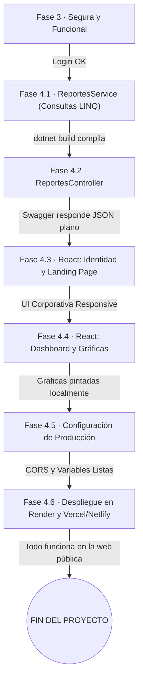

# Tareas — Fase 4: Analítica, Identidad Corporativa y Despliegue

> **Fase 4** · El orden final para construir los reportes y subir el aplicativo a internet. Cada paso termina en algo **verificable**. Requisitos: `2_spec_fase4.md` · técnica: `3_plan_fase4.md` · contratos: `6_contracts_fase4.md` · validación: `7_quickstart_fase4.md`.

---

**El orden de construcción, dibujado** — cada flecha lleva su compuerta de verificación.

## Fase 4.1 — ReportesService y Consultas Complejas (LINQ)
- [ ] Crear la carpeta `Peticiones/Reportes` y definir los DTOs genéricos de salida (ej. `GraficoBarraDto.cs`, `KpisDto.cs`).
- [ ] Crear `IReportesService.cs` y `ReportesService.cs` en la carpeta `Services/`.
- [ ] Implementar al menos 10 métodos asíncronos en el servicio. Cada uno debe usar el `_context`, aplicar filtros (`.Where(x => x.activo)`), realizar los JOINs (`.Include`), agrupar (`.GroupBy`), contar/sumar y proyectar (`.Select`) la data final en los DTOs creados.
- [ ] Inyectar el `IReportesService` en `Program.cs`.

**Verificar:** `dotnet build` compila sin errores.

## Fase 4.2 — ReportesController
- [ ] Crear `ReportesController.cs`.
- [ ] Proteger el controlador con `[Authorize(Roles = "Administrador, Consulta")]` (o el rol que decida el equipo).
- [ ] Crear los 10 endpoints `[HttpGet]` que expongan los métodos del servicio.

**Verificar:** Iniciar el backend. Entrar a Swagger, loguearse con el token de administrador y probar los endpoints de reportes. Deben devolver arreglos JSON como marca la Fase 4.

## Fase 4.3 — React: Identidad Corporativa y Landing Page
- [ ] Instalar Tailwind CSS (o Bootstrap) en el proyecto Vite si no se hizo antes.
- [ ] Definir los colores corporativos en la configuración global de CSS (ej. `tailwind.config.js`).
- [ ] Crear el `<LayoutPublico>` con un Navbar y un Footer.
- [ ] Construir las 5 vistas públicas: Inicio, Nosotros, Servicios, Contacto y Soporte.
- [ ] Asegurarse de que el botón "Iniciar Sesión" redirija al `/login` que ya construimos en la Fase 3.
- [ ] Reestructurar las rutas en `App.jsx` para separar claramente el layout público del layout privado.

**Verificar:** Ejecutar el frontend y navegar por las páginas públicas. Redimensionar el navegador para asegurar que sea *Responsive Design*.

## Fase 4.4 — React: Dashboard y Gráficas
- [ ] Instalar la librería de gráficos (ej. `npm install recharts`).
- [ ] Crear la vista `Dashboard.jsx` dentro del layout privado (requiere login).
- [ ] Usar `useEffect` y peticiones Axios para cargar los datos desde `ReportesController`.
- [ ] Renderizar las tarjetas de resumen (KPIs en la parte superior) y al menos 5 gráficos diferentes (barras, tortas, líneas) en una cuadrícula CSS Grid/Flexbox.
- [ ] Implementar estados de "Cargando..." y mensajes de "No hay datos suficientes" si la BD está vacía.

**Verificar:** Entrar al sistema con un rol válido, navegar al Dashboard y confirmar que los gráficos se muestran correctamente basados en los datos de prueba de Supabase.

## Fase 4.5 — Configuración para Producción
- [ ] En `mapa_conocimiento_client` (React), configurar `.env.production` (si aplica) preparando la variable genérica para la API. Asegurarse de tener el archivo de ruteo para el hosting (ej. `vercel.json` con `{"rewrites": [{"source": "/(.*)", "destination": "/index.html"}]}`).
- [ ] En `mapa_conocimiento_api` (C#), ir a `Program.cs` y modificar la política CORS para permitir "AnyOrigin" momentáneamente, o preparar una lista de orígenes permitidos que incluya la URL que le dará Vercel.
- [ ] Asegurarse de que el código base esté limpio y subido a GitHub en la rama `main`.

## Fase 4.6 — Despliegue en la Nube
- [ ] **Desplegar API:** Crear cuenta en Render (o MonsterASP/Azure). Conectar con el repositorio de GitHub. Seleccionar la rama `main` y la carpeta de la API. Configurar en Render las Variables de Entorno (`ConnectionStrings__Supabase` y `JwtSettings__Key`). Esperar a que el Build termine y obtener la URL pública (ej. `https://mapa-api.onrender.com`).
- [ ] **Desplegar Frontend:** Ir a Vercel o Netlify. Conectar con GitHub, seleccionar la carpeta del cliente (React). En la configuración de *Environment Variables* de Vercel, agregar `VITE_API_URL` apuntando a la URL pública que arrojó Render. Desplegar.

**Verificar Final:** Entrar a la URL pública de Vercel desde un celular. Ver la página corporativa. Hacer Login. Ver el Dashboard. **¡FELICIDADES, EL PROYECTO ESTÁ TERMINADO Y EN PRODUCCIÓN!**